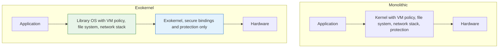

The [exokernel](https://dl.acm.org/doi/10.1145/224057.224076) (Engler, Kaashoek and O'Toole, SOSP 1995) is an operating system architecture in which the kernel only multiplexes hardware resources securely, and abstractions such as virtual memory, file systems and network stacks are implemented by library operating systems at application level. The design separates resource protection, which remains in the kernel, from resource management, which moves to the application.

## Citation

- [Exokernel: An Operating System Architecture for Application-Level Resource Management](https://dl.acm.org/doi/10.1145/224057.224076), Engler, Kaashoek, and O'Toole, SOSP 1995.

## Problem

Monolithic kernels prescribe the interfaces of key OS abstractions like virtual memory and the file system, and the prescribed interfaces impose a performance cost on applications. An application cannot modify or optimize the abstractions for its needs, so it must use a single general implementation that favors generality over performance for any specific workload. Commonly cited symptoms are databases that work around the file system and networking stacks that require extra copies.

## Main idea

The exokernel restricts the kernel to multiplexing hardware securely and leaves abstractions to the client. Its central design decision is the separation of resource protection from resource management. The exokernel provides secure bindings that grant access to a device or a physical page without interpreting how it will be used. Management, meaning the VM policy, file system or network stack, resides in a library operating system that the application links against and can replace or specialize.

The interface the kernel exposes should sit as close to the hardware as possible, using physical names like physical addresses directly. The design also allows applications to download code into the kernel to avoid crossing the user-kernel boundary, which resembles an early form of the mechanism eBPF provides today.

The same abstractions exist in both architectures; the exokernel moves them above the protection boundary.

## Why this helps

General-purpose kernel abstractions carry overhead in two ways. First, resources are so thoroughly abstracted that applications cannot manage them at all; exposing hardware-level names restores that control. Second, applications frequently cross into the kernel for operations that could run in user space, and the cost of the resulting context switches accumulates.

A small kernel interface also has design advantages. A kernel with few functions can optimize them aggressively, and a smaller code base is easier to maintain and offers fewer opportunities for defects. New functionality is added as a library OS rather than as a kernel change, which makes the system considerably easier to extend.

## Evidence

The authors built Aegis, an exokernel, plus ExOS, a library OS, and measured primitive operations against Ultrix, a mature Unix on the same hardware. Many primitives, including exception handling, virtual memory operations, and IPC, ran one to two orders of magnitude faster than Ultrix, and some outperformed contemporary state-of-the-art implementations. The improvements result from reduced context switching, low-overhead multiplexing of hardware, and specialized user-space implementations of the affected subsystems.

## Assumptions and limits

Compatibility work moves into user space. Each application developer or library OS maintainer becomes responsible for problems the kernel previously solved once, which is likely to reduce stability and reliability. Third-party library OSes are difficult to trust, and unless standards for user-space OS components are both developed and widely adopted, fragmentation is a significant risk. Porting is also harder. An application depends on its library OSes, and all of them must be ported to bring the application to a new exokernel.

## Open questions

- Why were exokernels never adopted? I found the paper's argument fully convincing.
- Can the approach be applied to modern workloads, particularly in datacenters?
- How can malicious or destructive library OSes be prevented?

## Sources

- [Exokernel: An Operating System Architecture for Application-Level Resource Management](https://dl.acm.org/doi/10.1145/224057.224076)

## Related notes

- [[systems/operating-systems/lecture-notes/components|Components of an OS]]
- [[systems/operating-systems/v1-kernels-and-processes/1-introductions|What Is an Operating System?]]
- [[systems/operating-systems/v1-kernels-and-processes/2-the-kernel-abstraction|The Kernel Abstraction]]
- [[systems/research/unix-timesharing-system|The Unix Timesharing System]]
- [[systems/research/xen|Xen and the Art of Virtualization]]
- [[systems/research/barrelfish|The Multikernel]]
