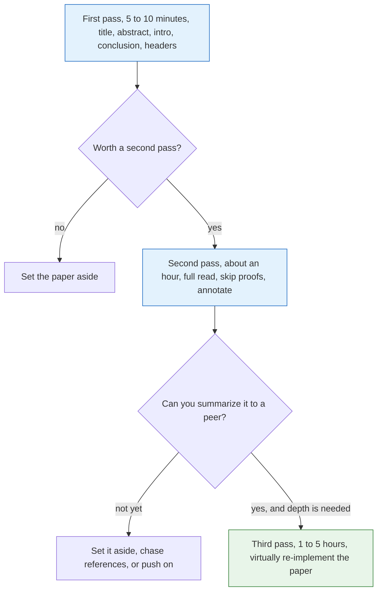

[Keshav's "How to Read a Paper"](https://web.stanford.edu/class/cs114/reading-keshav.pdf) describes a three-pass method for reading research papers, in which each pass reads the paper in more depth than the previous one and ends with a decision about whether to continue. I use it as the method behind my paper reviews.

## Problem

Researchers spend hundreds of hours reading papers every year, which makes reading effectively a valuable skill. Keshav argues that it is a learnable skill, and one that is rarely taught in school.

## The three-pass approach

Each pass ends with a decision about whether the paper merits the next one.

### First pass

The first pass gives a general idea of the paper's subject. It covers the title, abstract, introduction and conclusion, and only the section and sub-section headers of the body. The reader also glances over the references and notes which have already been read. The pass should take only 5-10 minutes.

After the first pass, the reader should be able to answer the five Cs:

- *Category*: What type of paper is this? (e.g. measurement, analysis)
- *Context*: Which other papers is it related to? What is the theoretical background?
- *Correctness*: Do the assumptions appear to be valid?
- *Contributions*: What are the paper's main contributions?
- *Clarity*: Is the paper well written?

### Second pass

The second pass aims to grasp the content of the paper, though not necessarily its details. It covers the whole paper but skips material such as proofs. Annotation and note-taking help during this pass, with particular attention to diagrams and to marking relevant unread references. The pass should take about an hour.

After this pass, the reader should be able to summarize the paper to a peer in a few sentences. A reader who still does not understand it has three options:

- Set the paper aside, in the expectation that its material will not be needed
- Return to the paper later, after looking up the references that were not understood
- Continue to the third pass regardless

### Third pass

The third pass aims at an in-depth understanding of the paper. The reader *virtually re-implements* the paper, following all of its reasoning and challenging every assumption, considers how the information could have been presented differently, and notes potential follow-up work along the way. The pass takes up to 5 hours, and at least 1 hour for a well-written paper and a well-read reader.

After this pass, the reader should be able to reconstruct the paper's structure from memory, critique it, and pinpoint implicit assumptions, limitations, and potential improvements.

## Sources

- [How to Read a Paper](https://web.stanford.edu/class/cs114/reading-keshav.pdf)

## Related notes

- [[systems/research/paper-review-template|Paper Review Template]]
- [[systems/research/strong-inference|Strong Inference]]
