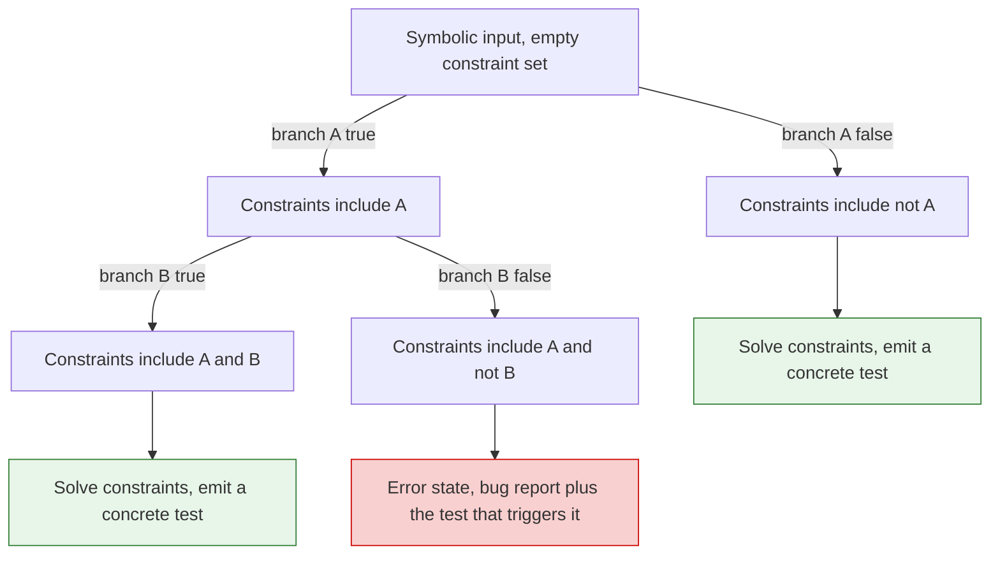

[KLEE](https://llvm.org/pubs/2008-12-OSDI-KLEE.pdf) (Cadar, Dunbar and Engler, OSDI 2008) is a symbolic execution engine that automatically generates high-coverage test cases for systems programs, including programs that interact with their environment through files, the network and system calls. It executes a program on symbolic inputs and solves the constraints accumulated along each path to obtain concrete inputs, which avoids the coverage limits of random testing.

## Citation

- [KLEE: Unassisted and Automatic Generation of High-Coverage Tests for Complex Systems Programs](https://llvm.org/pubs/2008-12-OSDI-KLEE.pdf), Cadar, Dunbar, and Engler, OSDI 2008. [Source code](https://klee.github.io/).

## Problem

Testing large and complex programs is difficult. Writing manual tests is very time-consuming and still misses edge cases. Automated random testing reaches limited coverage because random input generation makes no use of the semantics of the branch conditions it must satisfy. Other symbolic execution tools existed, but many could not handle environmental dependencies such as file I/O, network I/O and system calls, which account for a large share of a systems program's state space.

## Main idea

KLEE runs a program on symbolic inputs and maintains a set of constraints describing every operation performed on those inputs down each path. At each branch it forks the execution state and adds the branch condition (or its negation) to each side's constraints. Solving the constraints for a path yields a concrete test case that drives the real program down that exact path. The same machinery finds bugs, by checking whether any path reaches an error state, and checks functional equivalence, by comparing the constraints two programs generate on the same symbolic input.

Each branch on a symbolic value forks the state, so a run explores a tree of paths, each carrying its own constraint set:

## Mechanism

Two design decisions account for most of KLEE's practicality:

- KLEE keeps program execution state inside the engine itself, so forking at a branch never reruns the prefix of the path. Object-level copy-on-write keeps the memory cost of thousands of forked states low and makes backtracking inexpensive.
- Environmental dependencies are handled with models. Given a model of the file system or network, KLEE executes the program's interactions with the environment symbolically, in the same way that mocks replace dependencies in unit testing.

KLEE also simplifies and caches constraint queries before they reach the solver, since solver time dominates its running time.

## Evidence

Results reported in the paper:

- GNU Core Utils: 84.5% overall line coverage, against 67.7% for the developers' test suite
- Busybox: 90.5% overall line coverage, against 44.8% for the developers' test suite
- 100% line coverage on 16 Core Utils tools and 31 Busybox tools
- 56 serious bugs found across all tested applications
- Cross-checking equivalent Busybox and Core Utils utilities surfaced inconsistencies, some of which were bugs

Beyond the raw coverage, the semantic approach needed far fewer test cases than random testing to reach the same coverage.

## Assumptions and limits

State space explosion remains the limiting factor in practice, even with KLEE's optimizations. Support for some language features is limited, floating point and dynamic memory allocation among them. Compiling a large system to LLVM bitcode is also a substantial task in itself (`wllvm` assists with it).

## Open questions

- Can symbolic execution handle non-deterministic programs? Could KLEE's constraints capture the theoretical bounds of randomized algorithms?
- Is symbolic execution possible at a lower level, like the instruction set, or do the semantics stop being interpretable there? If so, the result would be a language-agnostic engine.
- Can the same constraint techniques simplify program logic by detecting redundant constraints?

## Sources

- [KLEE: Unassisted and Automatic Generation of High-Coverage Tests for Complex Systems Programs](https://llvm.org/pubs/2008-12-OSDI-KLEE.pdf)
- [KLEE source code](https://klee.github.io/)
- [ESD synthesis follow-up](https://dl.acm.org/doi/pdf/10.1145/1755913.1755946)

## Related notes

- [[systems/research/paper-review-template|Paper Review Template]]
