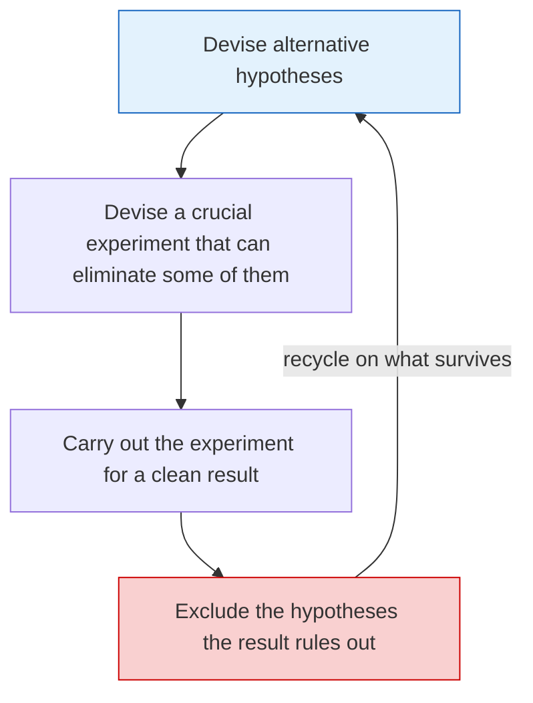

Strong inference, in John R. Platt's 1964 paper in *Science*, is the systematic application of the scientific method in a repeated cycle: devise alternative hypotheses, devise an experiment whose outcome excludes some of them, carry out the experiment, and repeat on the hypotheses that remain. Platt argues that the fields that progressed fastest in his time, molecular biology and high-energy physics, did so because they applied this cycle consistently.

I keep these reading notes with [[systems/research/how-to-read-a-paper|How to Read a Paper]] as part of the method behind my paper reviews; both concern research conducted by explicit method.

## Citation

- [Strong Inference: Certain systematic methods of scientific thinking may produce much more rapid progress than others](https://pages.cs.wisc.edu/~markhill/science64_strong_inference.pdf), John R. Platt, Science, 1964.

## Problem

Research practice in some fields is less systematic than in molecular biology and high-energy physics. Platt argues that when researchers do not follow a formal method, particularly in formulating hypotheses, the work is less efficient and progress is slower.

## Main idea

Platt attributes the rate of progress in these fields to a consistent application of the scientific method, which he calls strong inference. It consists of three steps, repeated:

1. **Devise alternative hypotheses.** Generate multiple competing hypotheses that could explain the phenomenon.
2. **Devise a crucial experiment.** Design an experiment that can unambiguously distinguish between the hypotheses, or at least eliminate some of them.
3. **Carry out the experiment.** Run it and analyze the results.

Strong inference applies this cycle systematically at every branch point of the logical tree of inquiry. Platt recommends keeping a notebook for it and giving particular attention to the generation of hypotheses. Much of the paper consists of historical examples of the method in practice and a detailed account of its application.

> [!quote] Two questions Platt recommends asking of any work
> "How would we know this hypothesis is wrong?" and "What hypothesis does this experiment disprove?"

## Why it works

In Platt's account, departures from strong inference appear as delays. Much experimental work is unproductive because the researcher did not first formulate hypotheses that an experiment could exclude. Applied consistently, the method approaches the minimum amount of work needed to make a discovery without relying on chance.

The method depends on the inductive step. The competing hypotheses must be logically sound and must cover the possibilities; otherwise the crucial experiment excludes none of them.

## Sources

- [Strong Inference](https://pages.cs.wisc.edu/~markhill/science64_strong_inference.pdf)

## Related notes

- [[systems/research/how-to-read-a-paper|How to Read a Paper]]
- [[systems/research/paper-review-template|Paper Review Template]]
