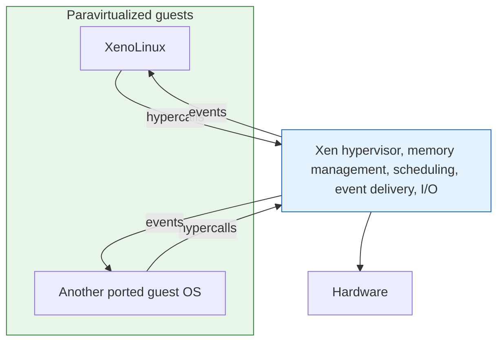

Paravirtualization is a form of virtualization in which the guest operating system is modified to run on a hypervisor and requests privileged operations through explicit calls to it, instead of running unmodified on emulated hardware. [Xen and the Art of Virtualization](https://www.cl.cam.ac.uk/research/srg/netos/papers/2003-xensosp.pdf) (Barham et al., SOSP 2003) presents Xen, a paravirtualizing hypervisor, together with the interface that keeps the required guest modifications small and an evaluation against native Linux and full virtualization.

## Citation

- [Xen and the Art of Virtualization](https://www.cl.cam.ac.uk/research/srg/netos/papers/2003-xensosp.pdf), Barham et al., SOSP 2003.

## Problem

Full virtualization emulates the underlying hardware completely so an unmodified guest OS can run on it. Emulation adds overhead, and it prevents guest OSes from accessing hardware features of the host that they need for correct and efficient operation, such as real time sources.

## Main idea

Xen is a hypervisor that runs multiple [[systems/operating-systems/v1-kernels-and-processes/1-introductions|operating systems]] on the same hardware through **paravirtualization**. Guest OSes are modified to be aware of the hypervisor and make calls to it for access to hardware features. Xen implements efficient mechanisms for memory management, scheduling, event delivery, and I/O inside the hypervisor, and delegates resources to guests through them. The paper demonstrates the resulting performance on **XenoLinux**, their port of Linux.

Control transfers in both directions, hypercalls going down and events coming back up:

## Key insights

A guest that is aware of virtualization can operate correctly (clocks, paging) and efficiently (fast handlers). Paravirtualization improves performance substantially over full virtualization at the cost of modifying the guest, and Xen keeps the modification small by exposing a simple interface that can be ported to a new OS with changes to a small part of the guest source.

Because most operations require no emulation, their latency and throughput overheads are low.

## Evidence

In the paper's evaluation, performance is close to native Linux for many workloads, and where it is below native it remains above that of the full-virtualization systems measured. Many guest OSes run concurrently, and the hypervisor's own memory footprint is small.

## Assumptions and limits

Guest OSes require modification, which raises the cost of adopting Xen for any new OS. Xen at the time also lacked SMP support inside guests, so some workloads remained substantially more efficient on native hardware.

## Open questions

- Could guest OSes be ported to hypervisor-awareness automatically or programmatically? Could new OS implementations conform to an interface that makes them hypervisor-compliant by construction?
- Has anyone worked on detecting hot spots, routines a guest calls constantly, and automatically registering fast handlers for them in the hypervisor?

## Sources

- [Xen and the Art of Virtualization](https://www.cl.cam.ac.uk/research/srg/netos/papers/2003-xensosp.pdf)

## Related notes

- [[systems/research/exokernel|Exokernel]]
- [[systems/research/barrelfish|The Multikernel]]
- [[systems/operating-systems/v1-kernels-and-processes/1-introductions|What Is an Operating System?]]
- [[systems/operating-systems/v1-kernels-and-processes/1-introductions|What Is an Operating System?]]
