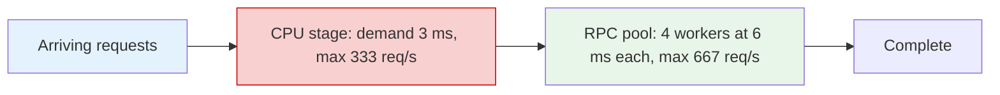

Operational laws are relations among long-run averages of a system's measured quantities (arrival rate, throughput, service demand, utilization, response time and population) that hold for any stable system, whatever the distributions of interarrival and service times. Three of them are used here: the utilization law, Little's Law and the bottleneck law.

Because they are identities of accounting for stable systems, these laws make no queueing-model assumptions. Many capacity arguments about load, headroom or the location of an optimization reduce to them.

## Model

Take one service stage with:

- arrival rate $\lambda$ requests/second
- throughput $X$ completions/second
- service time $S$ seconds/request
- response time $R$ seconds/request
- average number in service $U$
- average number in the whole system $N$

For a stable stage, long-run throughput equals long-run arrival rate:

$$
X = \lambda
$$

If the stage is unstable, the queue grows without bound and the long-run averages do not exist.

## Utilization Law

Applying Little's Law to the server alone, excluding the queue, gives the utilization as the average number of jobs in service:

$$
U = X S
$$

For a single server, $U$ is the busy fraction, so $0 \le U \le 1$.

With service rate $\mu = 1/S$:

$$
U = \frac{X}{\mu}
$$

The utilization law gives a direct test of feasibility. A stage that needs 3 ms of CPU per request, run at 500 requests/second on one core, has

$$
U = 500 \cdot 0.003 = 1.5
$$

A utilization above 1 is infeasible on one core, independently of any queueing model.

## Little's Law

For any stable subsystem:

$$
N = X R
$$

Average concurrency equals throughput times average time spent inside.

The subsystem may be chosen freely, for example:

- the whole service
- one queue
- one RPC stage
- one disk
- the decode queue of a model server

If a service completes 20,000 requests/second and the mean end-to-end time is 50 ms, the average number of concurrent requests is

$$
N \approx 20{,}000 \cdot 0.05 = 1000
$$

The law gives only the mean and says nothing about the width of the distribution. It does show that a steady-state design claiming 20k QPS at this response time with only a few requests in flight is inconsistent.

## Bottleneck Law

Suppose request $r$ visits stage $i$ an average of $V_i$ times and each visit costs service time $S_i$. The total demand per request at stage $i$ is

$$
D_i = V_i S_i
$$

Then stage $i$ cannot sustain throughput above

$$
X_i^{\max} = \frac{1}{D_i}
$$

for one server, or

$$
X_i^{\max} = \frac{m_i}{D_i}
$$

for $m_i$ identical servers.

The system throughput limit is the minimum across stages:

$$
X^{\max} = \min_i X_i^{\max}
$$

The stage with the largest demand per server therefore determines the throughput of the system.

## Worked Example

Suppose one request does:

- 2 ms of CPU
- 6 ms of network-bound downstream wait on a pool of 4 workers, each spending 6 ms of service
- 1 ms of local serialization

The demands are:

$$
D_{\text{cpu}} = 0.002 + 0.001 = 0.003
$$

and

$$
D_{\text{rpc}} = 0.006
$$

with $m_{\text{rpc}} = 4$, so

$$
X_{\text{cpu}}^{\max} = \frac{1}{0.003} \approx 333
$$

and

$$
X_{\text{rpc}}^{\max} = \frac{4}{0.006} \approx 667
$$

The CPU stage is the bottleneck. Reducing RPC service time does not raise the system limit until CPU demand decreases.



## Queueing Delay at High Utilization

Operational laws locate the throughput limit; queueing models describe how response time grows as load approaches it. In many systems response time behaves as follows:

- low utilization: $R \approx S$
- moderate utilization: queueing delay appears but remains small relative to $S$
- high utilization: tail latency grows rapidly

For this reason a bottleneck at 95% utilization can dominate the response time of the whole service even when every other stage is lightly loaded.

## Python Helper

```python
from dataclasses import dataclass

@dataclass
class Stage:
    name: str
    visits: float
    service_s: float
    servers: int = 1

    @property
    def demand_s(self) -> float:
        return self.visits * self.service_s

    @property
    def max_throughput(self) -> float:
        return self.servers / self.demand_s


stages = [
    Stage("cpu", visits=1, service_s=0.003, servers=1),
    Stage("rpc_pool", visits=1, service_s=0.006, servers=4),
]

for stage in stages:
    print(stage.name, stage.max_throughput)

print("system_limit", min(stage.max_throughput for stage in stages))
```

## Scope of the Operational Laws

The operational laws do not predict the latency distribution. They determine:

- whether a capacity plan is feasible
- how much concurrency a measured throughput implies
- which stage limits throughput

These results are sufficient to rule out many candidate explanations of a performance problem.

## Related Notes

- [[systems/scheduling/0-foundations/queueing-models-and-tail-latency|Queueing Models and Tail Latency]]
- [[systems/performance/latency-throughput-and-utilization|Latency, Throughput, and Utilization]]
- [[systems/operating-systems/v2-concurrency/7-queueing-theory|Queueing Theory]]
