Real-time scheduling assigns a processor to jobs that carry deadlines, and a schedule is **feasible** if every job completes by its deadline. A task set is **schedulable** under a policy if the policy produces a feasible schedule for every pattern of releases the task model permits.

The objective is therefore feasibility, a property of the worst case, whereas policies such as SRPT or processor sharing are evaluated by means and percentiles of response time. Performance criteria apply only among feasible schedules.

## Task Model

For periodic task $\tau_i$:

- computation time $C_i$
- period $T_i$
- relative deadline $D_i$

The simplest classical setting uses implicit deadlines:

$$
D_i = T_i
$$

Utilization is

$$
U = \sum_i \frac{C_i}{T_i}
$$

The model comes from [Liu and Layland (1973)](https://people.eecs.berkeley.edu/~culler/cs252-s05/papers/liu-layland.pdf), and every theorem below depends on its assumptions: tasks are periodic and independent, deadlines coincide with periods, worst-case execution times are known, preemption has no cost, and there is one processor. A **critical instant**, the release pattern that produces a task's worst response time, occurs when the task is released simultaneously with all higher-priority tasks (their Theorem 1), so the analyses need check only the synchronous release case.

## Earliest Deadline First

EDF is a dynamic-priority policy:

- among runnable jobs, it runs the one whose absolute deadline is earliest

In the implicit-deadline uniprocessor model, EDF is optimal: if any policy schedules the task set feasibly, EDF does.

A necessary feasibility condition is

$$
U \le 1
$$

and for implicit deadlines on one processor this is also sufficient for EDF (Liu and Layland, Theorem 7).

Optimality follows from an exchange argument, the same one that proves SRPT optimal for mean response time. Take any feasible schedule and find the first time it runs a job whose deadline is later than that of some other ready job. Swapping the next unit of execution between them keeps both jobs feasible: the earlier-deadline job finishes sooner, and the later-deadline job receives a slot that still precedes its later deadline. Repeated swaps transform any feasible schedule into the EDF schedule without introducing a miss, so if EDF misses a deadline, every policy does. Sufficiency of $U \le 1$ follows because EDF is work-conserving: the processor is idle only when no work is pending.

## Rate Monotonic

Rate monotonic (RM) is a fixed-priority policy:

- a task with a shorter period has a higher priority

Because priorities are static, RM is simpler to implement than EDF. Liu and Layland's utilization bound is

$$
U \le n(2^{1/n} - 1)
$$

for $n$ tasks.

As $n \to \infty$, this approaches

$$
\ln 2 \approx 0.693
$$

Every task set with utilization at most 69.3% is therefore schedulable under RM, and many task sets above that utilization are schedulable as well. The bound is tight, in that some task sets just above it are not schedulable under RM, but it is only *sufficient*, so a task set that fails it may still be schedulable. The priority assignment is optimal among fixed assignments: Liu and Layland show that if *any* fixed-priority assignment schedules a task set, rate-monotonic order does (Theorem 2). The difference in capacity between RM and EDF is therefore a consequence of fixing priorities, and no other fixed assignment reduces it.

> [!warning] The two utilization tests make different kinds of claim
> EDF's $U \le 1$ is exact for implicit deadlines: a task set that passes is schedulable, and one that fails is schedulable under no policy. RM's $n(2^{1/n}-1) \to 0.693$ bound is *sufficient only*; a task set that fails it may still be schedulable under RM, and [response-time analysis](#response-time-analysis) is the exact test. The gap between 0.693 and 1.0 is the capacity lost, in the worst case, by fixing priorities statically.

### Response-Time Analysis

The exact fixed-priority test, which is less pessimistic than the bound, computes each task's worst-case response time as a fixed point. For task $i$ with higher-priority tasks $j$:

$$
R_i = C_i + \sum_{j \in hp(i)} \left\lceil \frac{R_i}{T_j} \right\rceil C_j
$$

iterated from $R_i = C_i$ until it converges (schedulable if $R_i \le D_i$) or exceeds the deadline. The ceiling term counts the releases of each higher-priority task within the window. The test is exact under the model assumptions, and it applies to task sets with $D_i < T_i$, which the utilization bound does not cover.

## The Separating Example

A task set with utilization between the two bounds separates RM from EDF: $\tau_1 = (C{=}2, T{=}5)$, $\tau_2 = (C{=}4, T{=}7)$, so $U = 2/5 + 4/7 = 0.971$, above RM's 0.828 bound for two tasks and below EDF's 1.0. Simulated over the hyperperiod of 35 ticks (repo venv; the simulator releases jobs at period boundaries and selects a job by policy at each tick):

```plaintext
RM:  1122211222112.211222...   tau2 MISSES at t=7
EDF: 11222211222211211222...   no misses over the full hyperperiod
```

Under RM, the release of $\tau_1$ at $t=5$ preempts $\tau_2$, because $\tau_1$ has the shorter period. $\tau_1$ then occupies 4 of the 7 ticks before $\tau_2$'s deadline, leaving $\tau_2$ only 3 of the 4 it requires. Its response time satisfies $R = 4 + \lceil R/5 \rceil \cdot 2$, and the recurrence exceeds 7 ($R_2$ iterates $4 \to 6 \to 8 > 7$), so the set is unschedulable under RM, as the trace shows. Under EDF, at $t=5$ the running $\tau_2$ has deadline 7 and the newly released $\tau_1$ has deadline 10, so $\tau_2$ *continues to run*. A dynamic priority permits this decision and a fixed priority does not, and under EDF the set is schedulable at 97% utilization.

The first eight ticks are drawn below; the two schedules differ only in the decision at $t=5$.

```mermaid
gantt
    dateFormat X
    axisFormat %s
    section RM tau1
    job 1 :0, 2
    job 2 :5, 7
    section RM tau2
    3 of 4 ticks :2, 5
    deadline 7 missed :crit, 7, 8
    section EDF tau1
    job 1 :0, 2
    job 2 :6, 8
    section EDF tau2
    job 1 :2, 6
```



## Small Example

Consider two periodic tasks:

- $\tau_1: C_1 = 1, T_1 = 4$
- $\tau_2: C_2 = 2, T_2 = 5$

Then

$$
U = \frac{1}{4} + \frac{2}{5} = 0.65
$$

The set is schedulable under EDF because $U < 1$.

The RM bound for $n=2$ is

$$
2(\sqrt{2}-1) \approx 0.828
$$

The set also passes RM's sufficient bound, so it is schedulable under both policies.

## EDF and RM in Theory and Practice

EDF uses dynamic priorities and can schedule any task set with utilization up to 1 in the classical model. RM schedules fewer task sets in the worst case, in exchange for a simpler implementation and analysis under many embedded-system assumptions.

In deployed systems the tradeoff is often the following:

- EDF: more flexible, higher usable utilization
- RM: simpler fixed-priority mechanisms, simpler certification

## Schedulability Helper

```python
import math

def rm_bound(n: int) -> float:
    return n * (2 ** (1 / n) - 1)

def utilization(tasks):
    return sum(c / t for c, t in tasks)

tasks = [(1, 4), (2, 5)]
u = utilization(tasks)
print("U =", u)
print("EDF feasible?", u <= 1.0)
print("RM sufficient test?", u <= rm_bound(len(tasks)))
```

## Hard Real-Time Is Not Low Latency

The two goals are often conflated, although their methods differ in nearly every respect:

| | Hard real-time (EDF/RM) | Interactive low latency (MLFQ/EEVDF) |
| --- | --- | --- |
| Question | does *every* job meet its deadline? | are *most* responses fast? |
| Failure | one miss = system failure | a slow p99 = degraded, not broken |
| Analysis | offline schedulability proof from worst cases | online measurement of distributions |
| Load | admission-controlled to proven-feasible sets | best effort at any load |
| Optimizes | feasibility, then nothing else | means and percentiles |

A hard real-time system may run a task set with a high average latency, provided the schedulability proofs hold; an interactive scheduler may miss any individual "deadline," provided the tail remains acceptable. The engineering methods differ accordingly: real-time systems invest in predictability (WCET analysis, lock-free or priority-inheritance protocols, cache partitioning) and interactive systems in adaptivity. Linux provides both. `SCHED_DEADLINE` is a bandwidth-enforced EDF class with priority over the fair-share scheduler, with admission tests on the declared $(C, D, T)$ of each task, while ordinary threads are scheduled by EEVDF for soft latency ([[systems/operating-systems/v2-concurrency/7-multiprocessor-scheduling|multiprocessor scheduling]]).

## Caveats

The theorems above rest on several assumptions:

- one processor
- independent tasks
- no shared-resource blocking
- known worst-case execution times
- periodic or sporadic release models

With locks, I/O, multicore interference or cache effects, schedulability analysis becomes substantially more complex. A well-known hazard is **priority inversion**, in which a high-priority task is blocked on a lock held by a low-priority task that a medium-priority task repeatedly preempts. The repeated resets of the Mars Pathfinder lander are a widely cited instance, and priority inheritance, the protocol enabled to correct them, is the common mitigation. Each relaxation of the assumptions (deadlines shorter than periods, jitter, blocking terms) has a corresponding extension of the response-time test, and the recurrence above is the base case of a large literature.

## Related Notes

- [[systems/operating-systems/v2-concurrency/7-multiprocessor-scheduling|Multiprocessor Scheduling]]
- [[systems/scheduling/1-single-resource/fifo-sjf-srpt-rr-and-mlfq|FIFO, SJF, SRPT, RR, and MLFQ]]
- [[systems/scheduling/0-foundations/queueing-models-and-tail-latency|Queueing Models and Tail Latency]]

