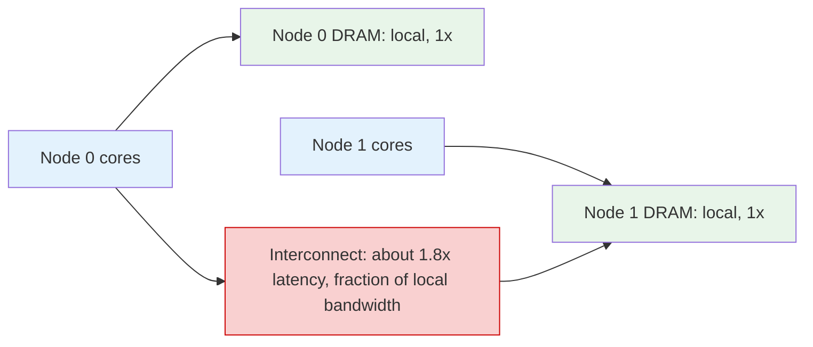

A non-uniform memory access (NUMA) machine is a multiprocessor in which the latency and bandwidth of a memory access depend on the location of the memory relative to the accessing core. NUMA-aware scheduling places threads, and the pages they access, so that the cost model includes the node on which a thread's memory resides as well as which CPU is free.

A scheduler that balances runnable-thread counts across nodes but ignores placement can leave every CPU busy while most threads run far from their pages, so that every cache miss crosses the interconnect. The cost hierarchy of migration is in [[systems/operating-systems/v2-concurrency/7-multiprocessor-scheduling|multiprocessor scheduling]], and the task-parallel view is in [[systems/scheduling/2-parallel-and-multiprocessor/work-stealing-affinity-and-numa|work stealing, affinity, and NUMA]].

## The Cost Asymmetry

A multi-socket machine is a network of nodes, each a package of cores with its own memory controller and local DRAM, joined by a cache-coherent interconnect (QPI/UPI, Infinity Fabric). A local access goes through the on-package controller; a remote access crosses the link, which adds latency and contends for link bandwidth. [Lameter's Queue article](https://queue.acm.org/detail.cfm?id=2513149) puts the remote penalty for a 2017-era two-socket Intel system at roughly **1.8x local latency**, with earlier SMP interconnects far worse; [Drepper](https://www.akkadia.org/drepper/cpumemory.pdf) measured read latency increasing with hop count on multi-hop AMD topologies (1.2-1.5x at one hop, approaching 2x at two). Bandwidth is divided in the same way. The interconnect's capacity is a fraction of the aggregate local DRAM bandwidth, so workloads dominated by remote accesses saturate the link well before the memory controllers. The single-socket bandwidth ceiling that motivates multi-threaded measurement in [[systems/operating-systems/benchmarks/bandwidth|the bandwidth benchmark]] has a second, lower ceiling for remote traffic, and the overlap arithmetic of the [[systems/operating-systems/benchmarks/mlp|MLP benchmark]] also degrades, since each outstanding remote miss occupies its miss-handling slot longer.

For scheduling, the relevant property is that the penalty applies per access and persists. A thread migrated across sockets does not incur a one-time cost, as with a cache refill; it incurs ~1.5-2x latency on every miss until its pages are also moved. NUMA placement is therefore a scheduling problem, and its cost is not limited to a warm-up period.

## Limits of CPU Load Balancing

Under first-touch allocation (the default, in which a page is allocated on the node of the CPU that first writes it), a thread's pages accumulate on the node where it starts running. Suppose the load balancer finds five runnable threads on socket 0 and three on socket 1 and migrates two threads across. CPU utilization equalizes, but the entire working sets of the migrated threads are now remote, and throughput can *fall* although the load appears better balanced. The balancer also lacks the information needed to choose which two threads to move: the appropriate choice is the pair with the smallest live working sets, which the runqueue does not record.

Two well-known patterns make this worse:

- **The migrated-parent trap**: a process starts on node 0, allocates its heap (first-touch: node 0), and is then balanced to node 1. Every child thread it spawns starts on node 1, and the shared heap remains remote for the life of the process.
- **The zero-page-init trap**: a single thread initializes a large array (all pages are allocated on its node), and a parallel phase then reads it from every node, so one memory controller serves the whole machine while three are idle. The remedy is to initialize the array in parallel with the partitioning the compute phase will use, which is application-level scheduling of *pages* rather than of threads.

## Placement Mechanisms

**Thread affinity.** Threads can be pinned to nodes (`sched_setaffinity`, `numactl --cpunodebind`), or the scheduler's NUMA domains can place them softly. Pinning makes placement predictable, at the risk of the load imbalance to which any affinity policy is exposed.

**Page placement policy.** The [kernel's NUMA memory policies](https://www.kernel.org/doc/html/latest/admin-guide/mm/numa_memory_policy.html) are `default` (first-touch/local), `bind` (restrict to nodes, fail otherwise), `preferred` (try one node, fall back), and `interleave` (round-robin pages across nodes). Interleaving gives up best-case locality in exchange for a uniform average cost, since every access averages over the topology. It outperforms local placement for shared structures accessed evenly from every node (page caches, large hash tables), because it spreads load that would otherwise concentrate on one memory controller.

**Page migration.** Data can be moved to the compute, either explicitly (`migrate_pages`, `move_pages`) or automatically. Linux's **AutoNUMA** balancing periodically unmaps pages and uses the resulting minor faults as a sampling probe. A page that repeatedly faults from a remote node is migrated toward the accessing node, or the task is migrated toward its pages; the kernel considers both. The probing and copying are overhead incurred on a prediction of future access patterns. For workloads whose access patterns shift faster than the sampling converges, the prediction fails, and for this reason databases and JVMs commonly disable AutoNUMA and place memory explicitly.

**Replication.** Read-mostly data can be replicated on every node (per-node copies of lookup tables, text segments). The kernel replicates its own read-only data in this way, and applications do so with per-node caches, at a cost in memory.

## Locality vs. Fairness vs. Utilization

Placement policy is shaped by three tensions:

- **Locality vs. utilization**: leaving a core idle on node 1 instead of migrating a node-0 thread to it preserves locality and leaves capacity unused; the break-even point depends on the thread's miss rate and working-set size. Linux encodes this reluctance in the structure of its scheduling domains: load balancing across NUMA domains runs less often and requires a larger imbalance than balancing within a socket. The rule is a static compromise in place of a per-thread calculation that would be too expensive to perform.
- **Locality vs. fairness**: a fair scheduler in the [[systems/scheduling/3-network-and-packet/fair-queueing-wfq-and-drr|max-min sense]] equalizes CPU time, but equal CPU time at unequal memory distance yields unequal *progress*, since a thread running remotely completes less work per allocated cycle. Fairness in progress on NUMA would require accounting for cycles weighted by achieved IPC, which no mainstream scheduler attempts; in practice, schedulers keep placement stable enough that the distortion remains small.
- **Packing vs. spreading**: threads bound by memory bandwidth perform better spread across nodes, where each uses its own controller (the scaling argument of the bandwidth benchmark), while threads that communicate heavily or share cache perform better packed onto one node, where coherence traffic stays on the package, as in the [[systems/operating-systems/benchmarks/false_sharing|false sharing benchmark]]. The two workloads require opposite placements, and a scheduler that cannot classify them must guess; gang-scheduled parallel jobs remove the guess by requesting a topology.

Datacenter schedulers face the same structure one level up, in the tradeoff between [[systems/scheduling/4-cluster-and-datacenter/cluster-scheduling-and-dominant-resource-fairness|placement quality and queue fairness]], with rack locality in place of socket locality. NUMA is the smallest instance of a general property: once data has a location, scheduling compute also schedules data movement.

## Diagnosing Placement Problems

A NUMA problem typically appears as high memory latency with unremarkable CPU metrics: the machine is busy, IPC is low, and no resource is saturated except the interconnect, which is not visible unless measured. Several tools measure placement directly. `numastat` reports per-node hit/miss/foreign counters, so a rising `numa_miss` count under load indicates remote traffic; hardware counters (`perf stat -e node-loads,node-load-misses`, or the offcore-response events) attribute remote accesses to code; and `numactl --hardware` shows the topology and per-node free memory (a full node forces remote allocations regardless of policy). The simplest experiment is to run the workload under `numactl --cpunodebind=0 --membind=0` and compare it with an unpinned run. If pinning to a single node, at *lower* nominal parallelism, outperforms the unpinned configuration, the balancer's placement is costing more than the extra cores provide, and explicit placement will improve throughput.

## Related Notes

- [[systems/operating-systems/v2-concurrency/7-multiprocessor-scheduling|Multiprocessor Scheduling]]
- [[systems/scheduling/2-parallel-and-multiprocessor/work-stealing-affinity-and-numa|Work Stealing, Affinity, and NUMA]]
- [[systems/operating-systems/benchmarks/bandwidth|Memory Bandwidth Benchmarks]]
- [[systems/operating-systems/benchmarks/mlp|Memory-Level Parallelism Benchmarks]]
- [[systems/operating-systems/benchmarks/false_sharing|False Sharing Benchmarks]]

## Sources

- [Lameter (2013), NUMA (Non-Uniform Memory Access): An Overview, ACM Queue 11(7)](https://queue.acm.org/detail.cfm?id=2513149)
- [Linux kernel docs, NUMA Memory Policy](https://www.kernel.org/doc/html/latest/admin-guide/mm/numa_memory_policy.html)
- [Drepper (2007), What Every Programmer Should Know About Memory](https://www.akkadia.org/drepper/cpumemory.pdf)
- [LWN, Memory part 4: NUMA support](https://lwn.net/Articles/254445/)
