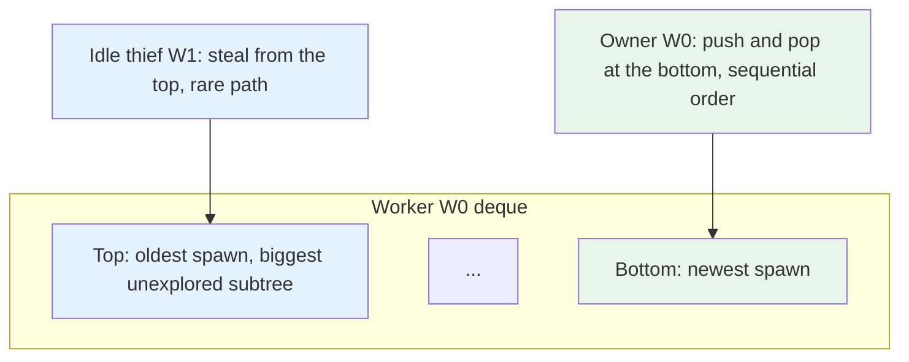

Work stealing is a scheduling discipline for dynamic parallel computations in which each processor keeps its own queue of ready tasks, and a processor whose queue is empty takes (steals) a task from the queue of another processor chosen at random. Load is balanced by idle processors only, so busy processors incur no scheduling coordination.

On multicore machines a placement policy must account for locality as well as load. Processor affinity keeps a thread on a core whose caches hold its state, and NUMA awareness keeps it near the memory it accesses; both constrain where work stealing may move a task.

## Work and Span

For a parallel computation DAG:

- $T_1$: total work, the time on one processor
- $T_\infty$: span, the critical-path time with infinite processors

No schedule on $P$ processors satisfies a tighter bound than

$$
T_P \ge \max\left(\frac{T_1}{P}, T_\infty\right)
$$

Work stealing comes within a constant factor of this lower bound in expectation for fully strict computations, without centralized scheduling.

## The Deque Discipline

Each worker owns a double-ended queue:

- owner pushes and pops from the bottom
- thieves steal from the top

The asymmetry has two consequences:

- Bottom operations are inexpensive and local in the common case.
- Older work near the top tends to expose more parallel slack, so a steal from the top transfers more work.

```python
class Worker:
    def __init__(self):
        self.deque = []

    def spawn(self, task):
        self.deque.append(task)        # push bottom

    def run_local(self):
        return self.deque.pop() if self.deque else None

    def steal_from(self, victim):
        return victim.deque.pop(0) if victim.deque else None
```

Production runtimes avoid `pop(0)`, which takes linear time on Python lists; the sketch shows only the policy.



A second argument for this discipline is that the owner's bottom-LIFO order is *the sequential execution order*. A worker from which nothing is stolen executes the DAG exactly as a single-threaded program would, with the same order, cache behavior and stack depth. This is the basis of the **work-first principle** of the [Cilk-5 papers](https://dl.acm.org/doi/10.1145/277650.277725): scheduling overhead belongs on the *steal* path rather than the *spawn* path, because in a well-parallelized program spawns occur $T_1$ times but steals only $O(P \cdot T_\infty)$ times. In Cilk's implementation a spawn costs only a few instructions more than a function call, while a steal incurs locks, continuation packaging and cache misses, so the overhead falls on the infrequent path. The same asymmetry distinguishes *continuation stealing* (Cilk: the thief takes the caller's continuation, and the owner continues executing the child it just spawned, depth-first) from *child stealing* (TBB, ForkJoinPool: the spawned child is queued and the owner continues in the caller). Child stealing is simpler to implement in a library without compiler support, at the cost of unbounded queue growth for some spawn patterns.

## A DAG and Its Trace

Recursive Fibonacci is a common example DAG because it is highly irregular: `fib(n)` spawns `fib(n-1)` and `fib(n-2)`, subtree sizes differ exponentially, and no static partition balances them. The following is a 3-worker trace of `fib(4)` with unit-cost nodes, in which W0 starts with the root:

```plaintext
tick  W0                    W1                    W2
1     fib(4): spawn 3,2     idle -> steal fib(3)? no work yet   idle
2     pop fib(2) (bottom)   steal fib(3) (top of W0)            idle
3     fib(2): spawn 1,0     fib(3): spawn 2,1     steal fib(2) (top of W1)
4     pop fib(0) -> 0       pop fib(1) -> 1       fib(2): spawn 1,0
...
```

W0's *bottom* pops proceed depth-first through the small subtree (sequential order), while thieves take from the *top*, which holds the oldest spawn and the largest unexplored subtree (`fib(3)` rather than `fib(1)`), so a single steal gives a thief a long run of local work. Steals are infrequent when the deques are deep, as the theorem predicts.

A complete toy runtime (workers as round-robin ticks, random victims, bottom-pop/top-steal, continuation bookkeeping via join counters) is small enough to run and measure. The results below are from the repo venv on `fib(10)`, 177 unit tasks:

| Workers | ticks | steals | speedup |
| --- | --- | --- | --- |
| 1 | 177 | 0 | 1.0 |
| 2 | 92 | 6 | 1.92 |
| 4 | 49 | 17 | 3.61 |

Speedup is nearly linear, and steals are under 10% of tasks. The $T_1/P$ term dominates, as the bound predicts for a DAG whose parallelism ($T_1/T_\infty \approx 177/\text{depth} \approx 20$) exceeds $P$. The core of the implementation is

```python
kind, arg, parent = self.deques[w].pop()      # owner: bottom (LIFO)
...
task = self.deques[victim].pop(0)             # thief: top (FIFO)
self.deques[w].append(task)
```

plus a join counter per spawn point (`[children_pending, accumulator, parent]`) that fires the continuation when the last child completes. Production runtimes replace the list with a **Chase-Lev deque**, a lock-free circular array in which owner and thief operate on opposite ends and a compare-and-swap is needed only when they contend for the last element.

## Performance Bound for Work Stealing

The principal result is that of Blumofe and Leiserson:

$$
E[T_P] = O\left(\frac{T_1}{P} + T_\infty\right)
$$

for fully strict computations under randomized stealing.

The bound rests on three properties:

- busy workers continue to execute local work
- idle workers steal only when parallelism exists elsewhere
- the cost of steals is charged mostly to the critical path rather than to all work

For these reasons task-parallel runtimes often use work stealing in place of one global queue.

## Implementations

The same design appears in several runtimes, with variations:

- **Cilk / Cilk Plus**: the reference design, with compiler-supported continuation stealing, the work-first principle and randomized victims; the setting of the theorem.
- **Intel TBB** and **Java ForkJoinPool**: library implementations with child stealing; ForkJoinPool adds *help-first* joining (a worker blocked on a join steals its own descendants' work rather than idling).
- **Rust rayon**: TBB-shaped, with `join(a, b)` as the primitive and scope-based lifetimes making the deque discipline memory-safe.
- **Go runtime**: goroutines in per-P local run queues with bottom-LIFO/top-steal, plus a global queue and network poller integration; a steal takes *half* the victim's queue, which lowers steal frequency at the cost of coarser balancing.
- **Linux CFS/EEVDF** differs: it uses per-CPU queues with periodic load balancing rather than stealing, because kernel threads are long-lived and carry priorities, unlike short cooperative tasks. This marks the limit of work stealing's applicability, since it assumes tasks that are numerous, short and equal in priority. Deadline or priority scheduling across jobs requires different mechanisms ([[systems/scheduling/1-single-resource/real-time-scheduling-edf-and-rate-monotonic|EDF and rate-monotonic]]).

## Affinity

Affinity also affects sequential request processing, where work stealing is not the central mechanism. If a thread runs again on the same core:

- its private caches are more likely to hold its data
- branch predictor state is more likely to reflect it
- its TLB entries are more likely to remain valid

The scheduler must then consider more than which core is idle:

- whether the work is runnable
- where its state is cached
- the cost of moving it

Per-core run queues are common for this reason.

## NUMA

On a NUMA machine, memory has a topology, and access to local DRAM costs less than access to remote DRAM. Thread placement and page placement are therefore coupled problems.

Balancing CPU load by moving a thread away from the memory it mostly accesses can improve CPU utilization while response time increases.

The cost model includes:

- migration cost of moving the runnable thread
- cache-warmup loss after migration
- remote-memory penalty if the thread stays but data moves badly

Multiprocessor schedulers in practice therefore often accept some load imbalance to preserve locality.

## Conflicts Between Work Stealing and Affinity

Work stealing moves tasks to idle processors as soon as possible, and affinity keeps tasks near their data. The two objectives are compatible when the scheduler:

- steals only when local work is exhausted
- steals tasks coarse enough that the loss of locality is amortized

They conflict when tasks are very small or access large amounts of data. A schedule that balances load can then lose most of its locality.

## Related Notes

- [[systems/operating-systems/v2-concurrency/7-multiprocessor-scheduling|Multiprocessor Scheduling]]
- [[systems/operating-systems/benchmarks/bandwidth|Memory Bandwidth]]
- [[systems/operating-systems/benchmarks/false_sharing|False Sharing]]
- [[systems/operating-systems/benchmarks/mlp|Memory-Level Parallelism]]

