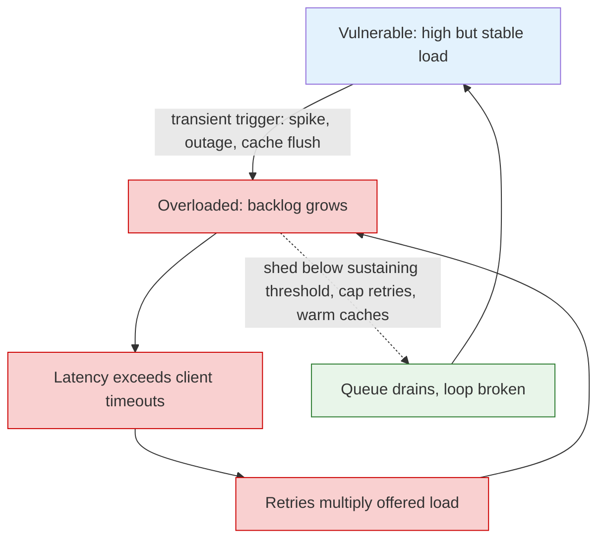

Admission control is the decision, made before a request enters a queue, whether to accept it, and overload management comprises the mechanisms that apply this decision when offered load exceeds capacity: rejection, load shedding, deadline enforcement, retry limits and backpressure. A scheduling policy orders work that has already been admitted; admission control determines which work is admitted.

When offered load exceeds capacity, the steady-state results of [[systems/scheduling/0-foundations/queueing-models-and-tail-latency|queueing models and tail latency]] no longer apply, because the backlog grows without bound. The scheduling problem is then to choose which work to refuse, how to signal upstream, and how to avoid failure modes in which overload sustains itself.

## Goodput

**Goodput** is the rate of work completed in time to be useful, that is, before the client's deadline and while the caller still wants the result. Under overload, throughput does not measure useful work, since a server can be 100% busy producing responses for which no caller is waiting. A saturated system that serves each request after its caller has timed out has full throughput and zero goodput, at full cost. The [SRE book's overload chapter](https://sre.google/sre-book/handling-overload/) is organized around the corresponding principle that returning errors quickly is preferable to returning successes slowly.

A simulation shows the mechanism. A server with capacity $\mu = 1000$ req/s receives $\lambda = 1500$ req/s, and clients time out after 1 s. Two configurations were run for 60 s (repo venv; event-driven at 1 ms ticks):

| | served/s | goodput/s | final queue |
| --- | --- | --- | --- |
| unbounded queue | 1000 | **50** | 86,898 and growing |
| queue bounded at 100, excess shed | 1000 | **1000** | 99 |

Throughput is identical. The latency of the unbounded queue grows linearly with time (backlog = $(\lambda - \mu)t$), so within seconds every request served has already exceeded its timeout. Goodput falls to the small number of requests served during the initial ramp and *remains* there, because the queue never drains. The bounded queue rejects 500 req/s on arrival, at low cost, and serves the rest within the deadline. Under sustained overload, the configuration that sheds is the only one of the two with nonzero steady-state goodput. The result is the clearest form of the queue-bounding argument in [[systems/performance/latency-throughput-and-utilization|Latency, Throughput, and Utilization]].

## Admission mechanisms

**Bounded queues, sized in time.** The appropriate size limit of a queue is set by the highest latency that is acceptable to serve: bound $\approx$ deadline x service rate. [CoDel](https://queue.acm.org/detail.cfm?id=2209336) refines this by replacing queue *length* as the signal. A full queue that absorbs a burst causes only transient delay, whereas a small standing queue that never empties adds latency to every request. CoDel therefore tracks each item's **sojourn time** and drops when the *minimum* sojourn over a window exceeds a target, which distinguishes bursts from standing queues without rate-dependent tuning.

**Priority-aware shedding.** Uniform rejection spends the rejection budget on inexpensive, critical requests while continuing to serve expensive batch work. The SRE practice is an explicit request **criticality** (four levels, from `CRITICAL_PLUS` down to `SHEDDABLE`), propagated through the call graph, with utilization thresholds per level, so that sheddable work is refused first and critical work only at the highest utilization.

**Token buckets at admission.** A token bucket of capacity $B$ refills at $r$ tokens/s, and each request consumes a token or is rejected. The sustained rate is limited to $r$, and bursts of up to $B$ requests are admitted, so the rate is shaped without a queue:

```python
class TokenBucket:
    def __init__(self, rate, burst):
        self.rate, self.burst = rate, burst
        self.tokens, self.last = burst, time.monotonic()

    def admit(self):
        now = time.monotonic()
        self.tokens = min(self.burst, self.tokens + (now - self.last) * self.rate)
        self.last = now
        if self.tokens >= 1.0:
            self.tokens -= 1.0
            return True
        return False       # caller sheds, degrades, or backpressures
```

**Client-side throttling.** Each rejection still costs the server work, and under heavy overload the rejections alone can saturate it. The SRE book's adaptive throttle moves rejection to the client, which tracks `requests` and `accepts` over a window and rejects locally with probability $\max\left(0, \frac{\text{requests} - K \cdot \text{accepts}}{\text{requests} + 1}\right)$ with $K \approx 2$. When the backend accepts every request, the client rejects none; as the accept rate falls, clients reduce their request rate proportionally, without coordination.

**Deadline propagation.** The remaining deadline is attached to every RPC; each hop subtracts its elapsed time, and a server that receives a non-positive budget drops the request without starting it. This eliminates work on requests that can no longer meet their deadline at every layer at once. Cancellation propagation, a related mechanism, reclaims work when the caller abandons a request for other reasons (see hedged requests in [[systems/scheduling/4-cluster-and-datacenter/stragglers-speculation-and-overload|stragglers and speculation]]).

## Retry amplification

Retries can turn a brief excess over capacity into a large one. If each of three layers of a call graph retries 3x on failure, one user action can become $3^3 = 27$ requests at the lowest layer, at the time that layer is least able to serve them. The [cascading-failures chapter](https://sre.google/sre-book/addressing-cascading-failures/) prescribes jittered exponential backoff on every retry, a per-request attempt cap (~3), and a per-client **retry budget** under which retries may not exceed ~10% of requests, so retry load is bounded at 1.1x rather than $k$x. A server can also return an explicit "overloaded, do not retry" response when its own measurements show that retries dominate its load, so that retries reduce load at the lower layer instead of amplifying it.

## Backpressure

Shedding discards work, whereas **backpressure** slows the producer by propagating a signal to defer work upstream, so the system runs at the rate of its bottleneck with bounded buffers at every stage. TCP flow control is the best-known example: the receiver's advertised window stops the sender, and the sender's API in turn blocks its application. The same pattern appears as bounded channels between pipeline stages, demand-based pull in streaming systems (downstream requests $n$ items; upstream may send no more), and connection-pool limits that make callers queue at the client rather than the server.

The choice between shedding and backpressure depends on the workload. Backpressure preserves work but couples the whole pipeline to its slowest stage, which is acceptable inside a batch job and harmful when the producer is a user. Shedding decouples the stages at the cost of lost work, which suits online serving, where a late response has no value. A system that does neither buffers instead, which reproduces the unbounded-queue row of the table above until memory is exhausted.

## Metastable failures

A metastable failure is an overload that persists after its trigger has gone. In the account of [Bronson et al.](https://sigops.org/s/conferences/hotos/2021/papers/hotos21-s11-bronson.pdf), a system in a *vulnerable* state (high but stable load) experiences a transient disturbance, such as a brief outage, a load spike or a cache flush, and enters a state in which a **sustaining feedback loop** keeps it overloaded even at the original load, which it previously served. Their principal examples correspond to the mechanisms above:

- **Retry storms**: timeouts cause retries, retries lengthen queues, and longer queues cause more timeouts. The load that sustains the failure is generated by the failure itself.
- **Cold caches**: a cache restart sends the full miss load at a backend provisioned only for the miss *rate* at steady state; the backend saturates, misses remain slow, and the cache does not refill. The trigger (restart) has passed, but the sustaining loop (empty cache -> overload -> empty cache) remains.
- **Slow-start failure loops**: a recovering server receives its full load-balancer share while its caches are cold, saturates, is marked unhealthy and restarts, which is the same loop expressed in [[systems/distributed-systems/load-balancing|load balancing]] terms.



Recovery therefore requires *breaking the loop*, since the trigger has already passed: load is shed below the sustaining threshold, retries are disabled, and caches are warmed before traffic is admitted. The preventive mechanisms are those described above. Retry budgets keep the loop gain of a retry storm below 1, bounded queues prevent the latency that causes timeouts, and admission control preserves a utilization margin in the vulnerable region. Capacity planning alone cannot prevent this class of failure, because the demand of the sustaining loop is generated internally, and overload management prevents it at low cost.

## Overload management in deployed systems

RPC servers use bounded thread pools and queues, criticality-tagged shedding, deadline propagation (gRPC deadlines), and circuit breakers as client-side refusal after repeated failure. Stream processors use credit-based flow control between operators (Flink), demand-based pull and watermark-driven load shedding for late data. Model servers apply admission before the batch queue, since an admitted GPU batch commits capacity for a full iteration; the continuous-batching admission decision in [[ml/serving-systems/batching|batching]] and the KV-cache pressure limits in [[ml/serving-systems/memory-management|memory management]] are the same bounded-queue argument with VRAM as the buffer.

## Related Notes

- [[systems/scheduling/0-foundations/queueing-models-and-tail-latency|Queueing Models and Tail Latency]]
- [[systems/scheduling/4-cluster-and-datacenter/stragglers-speculation-and-overload|Stragglers, Speculation, and Overload]]
- [[systems/performance/latency-throughput-and-utilization|Latency, Throughput, and Utilization]]
- [[systems/distributed-systems/load-balancing|Load Balancing]]
- [[ml/serving-systems/batching|Batching]]

## Sources

- [Google SRE Book, Handling Overload](https://sre.google/sre-book/handling-overload/)
- [Google SRE Book, Addressing Cascading Failures](https://sre.google/sre-book/addressing-cascading-failures/)
- [Bronson, Aghayev, Charapko, Zhu (2021), Metastable Failures in Distributed Systems, HotOS](https://sigops.org/s/conferences/hotos/2021/papers/hotos21-s11-bronson.pdf)
- [Nichols and Jacobson (2012), Controlling Queue Delay, ACM Queue](https://queue.acm.org/detail.cfm?id=2209336)
