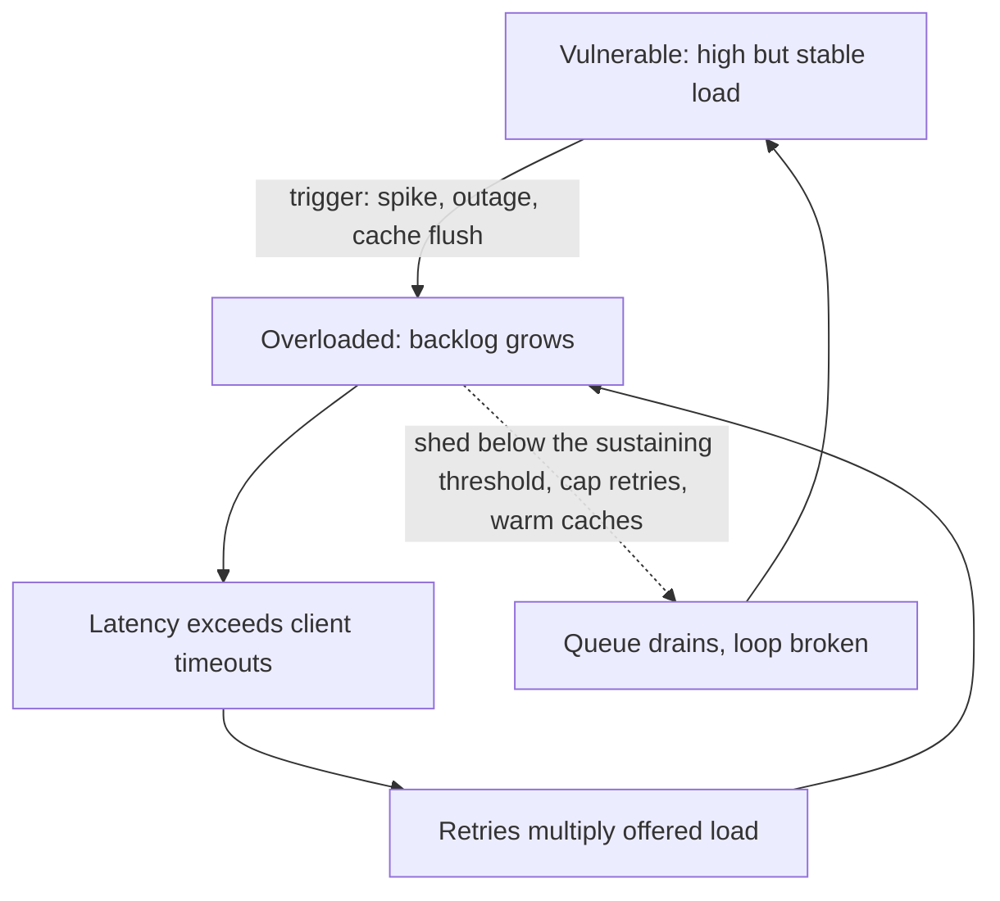

Admission control is the decision, made before a request enters a queue or begins service, whether to accept it. Overload management comprises the mechanisms that apply this decision when offered load exceeds capacity: rejection, load shedding, concurrency limits, deadline enforcement, retry limits and backpressure. A scheduling policy orders work that has already been admitted; admission control determines which work is admitted.

Below capacity, admission control changes little, and the steady-state results of [[systems/scheduling/0-foundations/queueing-models-and-tail-latency|queueing models and tail latency]] describe the system. Above capacity the backlog grows without bound, and response time grows with it until every response arrives after its caller has stopped waiting. The scheduling problem is then which work to refuse, where to refuse it, how to signal the refusal upstream, and how to keep retries from turning a brief overload into a lasting one.

## Goodput

**Goodput** is the rate of work completed in time to be useful: before the client's deadline, while the caller still wants the result. Throughput counts every completion, and under overload the two separate, because a server can be 100% busy producing responses that no caller is waiting for. The [SRE book's overload chapter](https://sre.google/sre-book/handling-overload/) is organized around the corresponding principle that returning errors quickly is preferable to returning successes slowly.

For a FIFO queue with no bound, the collapse follows from arithmetic. Let requests arrive at rate $\lambda$ to a server of capacity $\mu < \lambda$, each with deadline $D$. After time $t$ the backlog is $(\lambda - \mu)t$, so a request arriving at $t$ waits $(\lambda - \mu)t / \mu$. Every request that arrives after

$$t^* = \frac{\mu D}{\lambda - \mu}$$

misses its deadline, although the server stays fully busy serving earlier requests that have also missed theirs. Goodput is $\lambda$ until $t^*$ and zero afterwards. With $\mu = 1000$/s, $\lambda = 1500$/s and $D = 1$ s, $t^* = 2$ s: 3,000 requests are useful, which averaged over a 60 s run is 50 requests/s, while the steady-state goodput is zero and the backlog at 60 s is 30,000 requests.

A server that runs one thread or goroutine per request, with no limit, shares its processors among all requests in progress (processor sharing), and its collapse is gradual. With $n(t) \approx (\lambda - \mu)t$ requests in progress on $c$ cores, a request of size $w$ receives $c / n$ cores and finishes within $D$ only if $w \lesssim cD/n$. For exponential sizes with mean $s = c/\mu$ and large $n$, that probability is about $cD / (ns)$, so

$$\text{goodput}(t) \approx \frac{\lambda \mu D}{(\lambda - \mu)\, t},$$

which decays as $1/t$. Both disciplines spend almost all of their capacity, once the backlog has formed, on requests whose callers have given up.

## Measurement: a Go server past saturation

A small Go HTTP/2 server ([source](overload-lab/server/main.go)) runs on 2 pinned cores. Each request performs an exponentially distributed amount of SHA-256 hashing with a mean of about 1 ms, and the handler does not check whether its client is still waiting. A load generator on the other 2 cores ([source](overload-lab/loadgen/main.go)) offers an open-loop Poisson stream with a 100 ms client deadline. The generator must be open-loop: a closed-loop generator, which waits for a response before sending the next request, slows down as the server slows down and cannot drive it past saturation. Under the fixed limit, the server completed between 1,700 and 1,760 requests/s at every offered load from 2,000 to 4,000, so its capacity is about 1,750 requests/s. Each point is three 12 s runs with different seeds, summarized over seconds 2 to 12.

Five admission policies sit in front of the handler:

- **None**: `net/http` starts a goroutine per request, so every request begins service at once and shares the two cores.
- **Fixed limit**: at most 16 requests in progress; the 17th receives a 503 immediately. A thread pool with no queue, or a proxy's maximum-pending-requests threshold, has this shape.
- **Count-bounded queue**: 4 requests in progress and the rest in a FIFO queue of at most 1,000, beyond which requests receive a 503. A thread pool with a bounded work queue has this shape.
- **CoDel-style queue**: the same 4 workers and an unbounded FIFO queue with the controlled-delay rule from [Maurer's "Fail at Scale"](https://queue.acm.org/detail.cfm?id=2839461): if the queue has not been empty in the last $N = 100$ ms, a request may wait at most $M = 5$ ms, and otherwise at most $N$; a request that waited longer is shed when it reaches the head of the queue.
- **Gradient2**: an adaptive concurrency limit from [Netflix's concurrency-limits](https://github.com/Netflix/concurrency-limits/blob/main/concurrency-limits-core/src/main/java/com/netflix/concurrency/limits/limit/Gradient2Limit.java), described under [adaptive concurrency limits](#adaptive-concurrency-limits). Requests over the limit receive a 503.

Goodput in requests/s at each offered load (median of 3 runs), and p99 latency of successful requests at 3,000 offered:

| Policy | 1,400 | 1,700 | 2,000 | 2,400 | 3,000 | 4,000 | p99 at 3,000 |
| --- | --- | --- | --- | --- | --- | --- | --- |
| None | 1,395 | 1,573 | **199** | 104 | **53** | 36 | 99 ms |
| Count-bounded queue (1,000) | 1,395 | 1,692 | **0** | 0 | **0** | 0 | none succeed |
| Fixed limit (16) | 1,387 | 1,620 | 1,726 | 1,765 | 1,735 | 1,710 | 29 ms |
| CoDel-style queue | 1,394 | 1,676 | 1,745 | 1,743 | 1,753 | 1,678 | 62 ms |
| Gradient2 | 1,394 | 1,644 | 1,760 | 1,711 | 1,723 | 1,700 | 81 ms |
| Gradient, minimum RTT | 1,273 | 1,444 | 1,541 | 1,613 | 1,676 | 1,699 | 11 ms |

Without admission control, goodput tracks offered load up to 1,400 requests/s (80% of capacity) and collapses above saturation: 199 requests/s at 2,000 offered and 36 at 4,000, 2% of what was offered. The server was not idle. It finished 1,770 to 1,880 requests/s at every overloaded point, so between 89% and 98% of its work went to callers that had already given up. The per-second goodput follows the $1/t$ shape derived above: at 3,000 offered it fell from 679 in the first second to 29 in the twelfth. With $\mu \approx 1{,}800$, the approximation gives 39 for the twelfth second; the measured values sit between one half and three quarters of the approximation after the first few seconds, because $n$ keeps growing while each request is in service. At 1,700 offered, just below saturation, one of the three runs lost about 40% of its goodput to a backlog that formed and did not drain within the run.

The count-bounded queue behaves like no admission control below saturation and delivers nothing above it. At 2,000 offered it rejected 170 requests/s and let 1,819 time out: the queue stayed full, and a full queue of 1,000 is 0.57 s of waiting at this service rate.

The fixed limit, the CoDel-style queue and Gradient2 all held goodput between 1,678 and 1,765 requests/s up to 4,000 offered (2.3× capacity), within 5% of what the server completes when saturated. They differ in latency and in how much they shed below capacity:

- The **fixed limit** kept p99 latency at or below 30 ms at every load, and shed 15 requests/s (1%) at 1,400 offered.
- The **CoDel-style queue** shed 2 requests/s at 1,400, but its p99 rose from 30 ms at 1,700 to 76 ms at 4,000. Shedding a run of stale requests can empty the queue, which restarts the 100 ms window, so under sustained overload some requests are admitted after waiting up to 100 ms.
- **Gradient2** shed 6 requests/s at 1,400, and its p99 rose from 31 ms at 1,700 to 83 ms at 4,000, with 6 to 15 requests/s timing out. Its limit grew with load, from 21 at 1,400 offered to 38 at 3,000 in the first seed's runs, as its long-term RTT average rose from 2.3 ms to 10.2 ms.
- The **minimum-RTT gradient** shed requests well below capacity, 30 requests/s at 1,000 offered and 122 at 1,400, for the reason derived under [adaptive concurrency limits](#adaptive-concurrency-limits).

<OverloadLab policy="none" rate={2400} />

The lines in the figure come from a discrete-event simulation that runs in the page: Poisson arrivals, exponential service with mean $2/1750$ s, two cores shared equally among the requests in service, the same policy rules as the server, and a client that abandons each attempt after 100 ms while the server finishes it anyway. Its tests check it against the M/M/1 processor-sharing mean response time and the M/M/c/K blocking probability, and check that it reproduces the server's measured goodput within 7% of capacity at all 40 measured points. The simulation also runs combinations that were not measured: other offered loads in the spike, and client retries at steady load.

> [!note]- Measurement record
> - **Code**: [[systems/scheduling/4-cluster-and-datacenter/overload-lab/README|overload-lab]], with the [server](overload-lab/server/main.go), the [load generator](overload-lab/loadgen/main.go), [`run.py`](overload-lab/run.py) and [`summarize.py`](overload-lab/summarize.py). `run.py` starts a fresh server for every run, and `summarize.py` prints the tables and writes the figure's data. The raw results are [`results.jsonl`](overload-lab/results.jsonl), [`spike.jsonl`](overload-lab/spike.jsonl) and [`spike-noretry.jsonl`](overload-lab/spike-noretry.jsonl).
> - **Hardware and software**: a 4-vCPU cloud VM (Intel Xeon @ 2.10 GHz), Linux 6.18, Go 1.24.7. The server runs with `GOMAXPROCS=2` under `taskset -c 0,1` and the load generator under `taskset -c 2,3`. The host is shared with other tenants.
> - **Workload**: Poisson arrivals; per-request work of $N$ SHA-256 rounds with $N$ exponential, mean 11,000 (about 90 ns per round, so about 1 ms); a 100 ms deadline per attempt, enforced by the client with a context timeout, which resets the HTTP/2 stream. 16 HTTP/2 connections are used round robin, so that one connection's frame-processing goroutine does not limit the request rate.
> - **Handler**: the hashing loop calls `runtime.Gosched()` every 1,000 rounds (about 90 µs). Without it, a request admitted under the fixed limit held a core for its whole service time, the HTTP/2 connection goroutines waited behind up to 16 such requests, and at most 6 requests reached the handler at once, so the transport rather than the policy set the admission rate.
> - **Gradient2 port**: the update rule of `Gradient2Limit` with a minimum limit of 2 and an initial limit of 16 (the library defaults to 20 for both, above the fixed limit measured here), updated once per window of at least 50 ms and 10 completions.
> - **Runs**: 6 policies (the five above and the minimum-RTT gradient) × 8 offered rates × 3 seeds, 12 s each, summarized over seconds 2 to 12. The spike experiment: 4 policies with 2 retries and the server without admission control without retries, 3 seeds each, 16 s each.
> - **Goodput** counts responses with status 200 that arrived within 100 ms of the attempt being sent, attributed to the second in which the caller arrived. A caller with retries counts once, as good if any attempt succeeded.

## Admission mechanisms

### Bounded queues, sized in time

A queue's bound should follow from the waiting time the system can still use. By [[systems/scheduling/0-foundations/littles-law-and-bottleneck-analysis|Little's law]], a FIFO queue of length $L$ drained at rate $\mu$ holds a request for about $L/\mu$, so a waiting budget $D_q$ corresponds to a bound of roughly $L \approx D_q \mu$. The count-bounded queue above shows the cost of choosing $L$ by count: 1,000 entries at 1,750 requests/s is 0.57 s of waiting, more than five times the 100 ms deadline, so the bound engages only after every request is already late. A bound in count is also correct for only one service rate; if requests become twice as expensive, the same count holds twice as much time.

[CoDel](https://www.rfc-editor.org/rfc/rfc8289) bounds time directly. It was designed for router buffers: it timestamps each packet on arrival and computes its **sojourn time** at dequeue. Once the sojourn time has stayed above a target (5 ms) for a whole interval (100 ms), CoDel enters a dropping state and drops packets at intervals of $\text{interval}/\sqrt{\text{count}}$ until the sojourn time falls below target ([RFC 8289](https://www.rfc-editor.org/rfc/rfc8289), sections 4 and 5). Requiring the excess to persist for an interval distinguishes a burst, which drains within the interval, from a standing queue, which does not. Facebook's RPC servers use the simplified variant measured above ([Maurer 2015](https://queue.acm.org/detail.cfm?id=2839461)). The same article describes **adaptive LIFO**: the queue is served FIFO normally and LIFO once a queue forms, so that under overload the newest requests, whose callers are most likely still waiting, are served first.

### Concurrency limits

A **concurrency limit** caps the requests in progress and rejects or queues the rest. By Little's law, a limit $L$ on a server with throughput $X$ bounds the mean time in the server at $L/X$, so a limit is a latency bound expressed in requests. A fixed limit fails in two directions. Set too low, it rejects requests that the server could have served, which the measurements show below saturation: at 1,400 requests/s (80% of capacity) the limit of 16 shed 15 requests/s, because Poisson arrivals periodically put more than 16 requests in progress at once. Set too high, it admits enough concurrent work that the admitted requests miss their deadlines. The right value depends on the service time, which changes with the request mix, the deployment, and the latency of downstream dependencies.

### Adaptive concurrency limits

An adaptive limit adjusts $L$ from measured latency, as TCP Vegas adjusts a congestion window. Netflix's [concurrency-limits](https://github.com/Netflix/concurrency-limits) library implements several such limiters. The **gradient** limiter of their [2018 post](https://netflixtechblog.medium.com/performance-under-load-3e6fa9a60581) compares the unloaded round-trip time with the current one:

$$L_{\text{new}} = L \cdot \frac{\text{RTT}_{\text{noload}}}{\text{RTT}_{\text{actual}}} + \sqrt{L}.$$

A gradient of 1 indicates no queueing, and the $\sqrt{L}$ term lets the limit grow; a gradient below 1 indicates requests queueing inside the server, and the limit shrinks. The library clamps the gradient to $[0.5, 1]$ and smooths the update as $L \leftarrow 0.8L + 0.2L_{\text{new}}$.

Estimating $\text{RTT}_{\text{noload}}$ as the minimum observed RTT assumes requests of similar cost. With exponentially distributed work, some requests take microseconds, the minimum RTT approaches zero, the gradient sits at its floor of 0.5, and the smoothed update has a fixed point where $L = 0.8L + 0.2(0.5L + \sqrt{L})$, so $\sqrt{L} = 2$ and $L = 4$. In every measured run the limit settled at 4.00, and the limiter shed 30 requests/s at 1,000 offered (57% of capacity) and 122 at 1,400, where the other policies shed at most 15. Above saturation it held goodput like the others, with the lowest latency (p99 about 11 ms), because 4 requests in progress on 2 cores leave almost no queue.

The library's `Gradient2Limit` replaces the minimum with a long-term exponential average of the RTT over about 600 updates and adds a tolerance:

$$L_{\text{new}} = L \cdot \operatorname{clamp}\!\left(\frac{1.5 \cdot \text{RTT}_{\text{long}}}{\text{RTT}_{\text{short}}},\ 0.5,\ 1\right) + 4,$$

where $\text{RTT}_{\text{short}}$ is the average over the current window. The long-term average decays by 5% per update while it exceeds twice the short-term one, and the limit does not grow while fewer than $L/2$ requests are in progress. The reference is the system's own recent history, so the limit follows changes in request cost, and it drifts upward under sustained load because the long-term average absorbs the queueing it is meant to detect. In the measurements the limit settled near 21 at 1,400 offered and near 38 at 3,000, and p99 latency reached 81 ms at 3,000 offered against a 100 ms deadline. The limit protected goodput at every load, at a latency that a deadline below about 80 ms would not have accommodated.

### Priority-aware shedding

Uniform rejection spends the rejection budget on inexpensive, critical requests while continuing to serve expensive batch work. The SRE practice is an explicit request **criticality** with four values, `CRITICAL_PLUS`, `CRITICAL`, `SHEDDABLE_PLUS` and `SHEDDABLE`, propagated through the call graph, with a utilization threshold per value, so that sheddable work is refused first and critical work only at the highest utilization ([Handling Overload](https://sre.google/sre-book/handling-overload/)).

### Token buckets at admission

A token bucket of capacity $B$ refills at $r$ tokens/s, and each request consumes a token or is rejected. The sustained rate is limited to $r$ and bursts of up to $B$ requests are admitted, so the rate is shaped without a queue:

```python
import time

class TokenBucket:
    def __init__(self, rate: float, burst: float):
        self.rate, self.burst = rate, burst
        self.tokens, self.last = burst, time.monotonic()

    def admit(self) -> bool:
        now = time.monotonic()
        self.tokens = min(self.burst, self.tokens + (now - self.last) * self.rate)
        self.last = now
        if self.tokens >= 1.0:
            self.tokens -= 1.0
            return True
        return False  # the caller sheds, degrades, or backpressures
```

A rate limit protects a server only when $r$ is below what the server sustains for the current request mix, the same tuning problem as a fixed concurrency limit. Its natural use is allocating capacity among clients or tenants, where the rate itself is the quantity being allocated.

### Client-side throttling

Each rejection still costs the server work. In the measurements a rejection cost far less than a request served, but at 4,000 requests/s offered the server still answered about 2,300 rejections per second. The SRE book's **adaptive throttling** moves rejection to the client. Each client tracks, over the last two minutes, the number of `requests` it attempted and the number of `accepts` the backend returned, and rejects locally with probability

$$\max\left(0,\ \frac{\text{requests} - K \cdot \text{accepts}}{\text{requests} + 1}\right),$$

with $K = 2$ in Google's practice ([Handling Overload](https://sre.google/sre-book/handling-overload/)). While the backend accepts everything, the client rejects nothing; as the accept rate falls, clients reduce what they send without coordinating with one another.

### Deadline propagation

The remaining deadline travels with every RPC, each hop subtracts its elapsed time, and a server checks the remaining budget before each stage and abandons work that can no longer finish in time ([Addressing Cascading Failures](https://sre.google/sre-book/addressing-cascading-failures/)); gRPC deadlines implement this. The handler in the measured server checks nothing, which is why the server without admission control finished about 1,800 requests/s at 3,000 offered and delivered 53 of them in time. Cancellation propagation, a related mechanism, reclaims work when the caller abandons a request for other reasons (see hedged requests in [[systems/scheduling/4-cluster-and-datacenter/stragglers-speculation-and-overload|stragglers and speculation]]).

## Retry amplification

Retries turn a brief excess over capacity into a larger one. The [cascading-failures chapter](https://sre.google/sre-book/addressing-cascading-failures/) works an example in which the client JavaScript, the frontend and the backend each issue 3 retries (4 attempts), so one user action can produce $4^3 = 64$ attempts at the database, at the moment the database is least able to serve them. Its prescriptions are randomized exponential backoff, a per-request limit of about 3 attempts, and a per-client **retry budget** under which a request is retried only while retries are below 10% of requests, which bounds the load growth from retries at about 1.1×. A server whose own measurements show that it is overloaded can also return an explicit "overloaded; don't retry" error, so that only the layer directly above it retries ([Handling Overload](https://sre.google/sre-book/handling-overload/)).

The retry loop is visible on the measured server. With offered load at 1,400 requests/s (80% of capacity), clients that retry a failed attempt twice and immediately, and a spike to 3,500 requests/s from 4 s to 6 s, the server without admission control did not recover. During the spike the attempt rate rose to 8,300 and then 10,200 per second. After it, callers arrived at 1,400/s again, but every caller used all three attempts, so the server received about 4,200 attempts/s, and goodput stayed between 10 and 29 requests/s for the remaining 10 s of the run. The trigger had ended and the overload continued. Without retries, the same spike cost 6 s of goodput after it ended, while the backlog drained, and the server then returned to 1,400 requests/s. With the fixed limit, the CoDel-style queue or Gradient2, the retries still raised the attempt rate to between 8,200 and 8,900 per second during the spike, but rejections are inexpensive, goodput stayed between 1,690 and 1,800 requests/s during the spike, and it returned to the offered rate in the first second after it. Choose the spike and 2 retries in the [figure](#measurement-a-go-server-past-saturation) to replay these runs next to the simulation.

## Backpressure

Shedding discards work, whereas **backpressure** slows the producer by propagating a signal upstream, so the system runs at the rate of its bottleneck with bounded buffers at every stage. TCP flow control is the best-known example: the receiver's advertised window stops the sender, and the sender's socket buffer, once full, blocks its application. The same pattern appears as bounded channels between pipeline stages, demand-based pull in streaming systems (downstream requests $n$ items, and upstream may send no more), credit-based flow control between operators in Apache Flink, and connection-pool limits that make callers queue at the client rather than at the server.

The choice between shedding and backpressure depends on who waits. Backpressure preserves work but couples the whole pipeline to its slowest stage, which suits a batch job. For an online request whose caller has a deadline, backpressure only moves the wait to a different buffer. Shedding decouples the stages at the cost of lost work, which suits online serving, where a late response has no value. A system that does neither buffers instead, and behaves like the server without admission control above until memory is exhausted.

## Metastable failures

A metastable failure is an overload that persists after its trigger has gone. In the account of [Bronson et al.](https://sigops.org/s/conferences/hotos/2021/papers/hotos21-s11-bronson.pdf), a system whose load rises above a threshold enters a **vulnerable** state in which it still serves its load; a **trigger** (a load spike, a brief outage, a cache flush) pushes it into a bad state; and a **sustaining effect**, a feedback loop, keeps it there after the trigger is removed. The paper's examples of sustaining effects are:

- **Request retries**: timeouts cause retries, retries add load, and the added load causes more timeouts. The load that sustains the failure is generated by the failure itself.
- **Look-aside caches**: after the cache loses its contents, the backend receives the full miss load, which it was not provisioned for; it saturates, responses are slow, and the cache does not refill.
- **Slow error handling**: when the error path costs more than the success path (logging, stack traces, fallbacks), the work per request rises with the error rate.
- **Link imbalance**: a degraded link receives a growing share of traffic through the same mechanisms that react to its slowness.

[Huang et al.](https://www.usenix.org/conference/osdi22/presentation/huang-lexiang) studied 22 metastable failures from 11 organizations and found that at least 4 of 15 major AWS outages in the preceding decade were metastable failures.



Recovery requires breaking the loop, because the trigger has already passed: shedding load below the level at which the loop sustains itself, disabling retries, and warming caches before admitting traffic. The preventive mechanisms are those above. Retry budgets keep the gain of the retry loop near 1, admission control keeps latency below the timeouts that start retries, and both keep a margin between the vulnerable state and saturation. Added capacity moves the threshold but does not remove the loop, because the retry load is generated by the system's own failures and grows with them.

## Overload management in deployed systems

RPC frameworks combine bounded thread pools or concurrency limits, criticality-tagged shedding, deadline propagation (gRPC deadlines) and circuit breakers, which refuse at the client after repeated failures. Stream processors rely on backpressure: credit-based flow control between operators in Flink, demand-based pull in Reactive Streams. Model servers apply admission before the batch queue, since an admitted request holds KV-cache memory for its whole generation; the continuous-batching admission decision in [[ml/serving-systems/batching|batching]] and the KV-cache limits in [[ml/serving-systems/memory-management|memory management]] are the bounded-queue argument with GPU memory as the buffer, and [[systems/scheduling/5-ml-and-serving/request-scheduling-for-llm-serving|request scheduling for LLM serving]] treats that admission step in detail.

## Related Notes

- [[systems/scheduling/0-foundations/queueing-models-and-tail-latency|Queueing Models and Tail Latency]]
- [[systems/scheduling/0-foundations/littles-law-and-bottleneck-analysis|Little's Law and Bottleneck Analysis]]
- [[systems/scheduling/4-cluster-and-datacenter/stragglers-speculation-and-overload|Stragglers, Speculation, and Overload]]
- [[systems/performance/latency-throughput-and-utilization|Latency, Throughput, and Utilization]]
- [[systems/distributed-systems/load-balancing|Load Balancing]]
- [[ml/serving-systems/batching|Batching]]

## Sources

- [Google SRE Book, Handling Overload](https://sre.google/sre-book/handling-overload/)
- [Google SRE Book, Addressing Cascading Failures](https://sre.google/sre-book/addressing-cascading-failures/)
- [Nichols, Jacobson, McGregor, Iyengar (2018), RFC 8289: Controlled Delay Active Queue Management](https://www.rfc-editor.org/rfc/rfc8289)
- [Maurer (2015), Fail at Scale, ACM Queue](https://queue.acm.org/detail.cfm?id=2839461)
- [Netflix Technology Blog (2018), Performance Under Load](https://netflixtechblog.medium.com/performance-under-load-3e6fa9a60581)
- [Netflix concurrency-limits, Gradient2Limit.java](https://github.com/Netflix/concurrency-limits/blob/main/concurrency-limits-core/src/main/java/com/netflix/concurrency/limits/limit/Gradient2Limit.java)
- [Bronson, Aghayev, Charapko, Zhu (2021), Metastable Failures in Distributed Systems, HotOS](https://sigops.org/s/conferences/hotos/2021/papers/hotos21-s11-bronson.pdf)
- [Huang et al. (2022), Metastable Failures in the Wild, OSDI](https://www.usenix.org/conference/osdi22/presentation/huang-lexiang)
