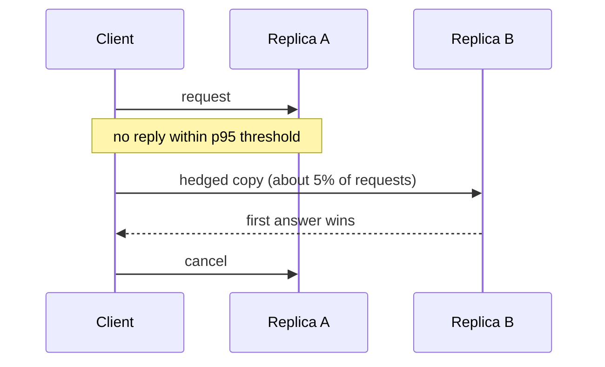

A straggler is a subtask of a parallel job or fan-out request that completes much later than its peers, and because the job completes only when its last subtask does, a straggler determines the job's completion time. Overload is the condition in which admitted work exceeds capacity, so that queues grow and response times increase without bound.

Schedulers respond to stragglers by duplicating work (speculative execution, hedged and tied requests) and to overload by refusing work (admission control). Duplication spends extra resources on individual subtasks to reduce the completion time of the whole job, and refusal sacrifices some requests to keep the response time of the rest bounded.

## Stragglers

In fan-out systems, completion time is often

$$
T = \max(T_1, \dots, T_k)
$$

for shard requests or parallel tasks, so the slowest subtask determines the completion time of the whole operation.

Causes include:

- noisy neighbors
- cache misses
- unlucky placement
- transient hardware slowdown
- skewed input partitions

If each of $k$ subtasks independently exceeds a threshold with probability $p$, the job exceeds it with probability $1 - (1-p)^k$, which is 63% at $k = 100$ and $p = 0.01$. The per-server p99 is then close to the median of the fan-out request. Percentiles under fan-out are treated in full in [[systems/performance/tail-latency-percentiles|Tail Latency and Percentiles]].

## Speculative Execution

Batch systems such as MapReduce launch duplicates of the slowest remaining tasks near the end of a job, and a task completes when either copy finishes. The [MapReduce paper](https://research.google/pubs/pub62/) reports that with backup tasks disabled, its sort benchmark took **44% longer**, the additional time coming from its last few stragglers, while backup execution added only a few percent of compute. The mechanism follows from the arithmetic above. Near the end of a job most tasks have finished and idle capacity is plentiful, so a duplicate costs little, and the minimum of two draws from a distribution that contains stragglers has a much shorter tail. In a simulation (repo venv) of 10,000 tasks with exponential runtimes, 1% of them inflated 10x, the maximum in the last wave falls from 66.5 to 11.0 time units when stragglers receive one backup copy.

Speculation is effective when:

- late tasks are few (speculation applies to the last stragglers, not the whole job)
- idle capacity exists (as it does at the end of a job)
- stragglers are slow for *machine* reasons (noisy neighbor, bad disk) rather than *input* reasons; a duplicate of a skewed partition is equally slow, and skew requires repartitioning instead of speculation

It is harmful when:

- the cluster is already overloaded, so duplicates only add load
- the slowdown has a shared cause (a hot HDFS block, a saturated rack switch), so the copy competes for the same bottleneck and doubles its load

## Hedged Requests

Online services apply the same idea at the timescale of a request. The client sends the request to one replica, and if no response arrives within a delay threshold, often the ~95th-percentile latency, it sends a copy to a second replica and uses the first answer. The threshold keeps the cost low: by construction only ~5% of requests are hedged, and those are the requests already in the tail. [The Tail at Scale's](https://research.google/pubs/the-tail-at-scale/) benchmark reads 1,000 keys across 100 BigTable servers; hedging after a 10 ms wait reduced p99.9 from **1,800 ms to 74 ms** for ~2% extra requests.



A short simulation reproduces the shape of the distribution (repo venv, lognormal population, hedge sent above the p95 at 5.19, second draw independent):

| | p95 | p99 | p99.9 | extra load |
| --- | --- | --- | --- | --- |
| no hedge | 5.19 | 10.29 | 22.05 | none |
| hedge after p95 | 5.19 | 6.68 | 9.37 | 5.0% |

Because a fan-out request takes the maximum over servers, reducing each server's tail has a compounded effect: at fan-out 100, the p50 falls from 11.7 to 7.0 and the p99 from 41.4 to 12.9. A reduction in the tail at the leaves reduces the median at the root.

**Tied requests** apply duplication earlier. The request is enqueued on *two* servers immediately, each tagged with the identity of the other, and whichever server dequeues it first sends a cancellation to the other. This reduces queueing delay (the largest variable component of latency) without waiting for a hedge threshold, at the cost of cancellation traffic and a race when both servers dequeue at once (mitigated by a small jitter). The Tail at Scale reports that in a BigTable/GFS benchmark tied requests reduced median latency by 16% and p99.9 by ~40%, and that a cluster running a concurrent large sort job with tied requests had latency within a few percent of a mostly idle cluster without them.

The risk is the same as for speculation. Indiscriminate duplication adds load when the system is already near capacity, and a surge of hedges during a slowdown acts as a retry storm generated by the client (the metastable pattern in [[systems/scheduling/4-cluster-and-datacenter/admission-control-backpressure-overload|admission control and overload]]). Four design rules limit this effect:

- hedge only after a delay threshold tied to a live percentile estimate
- cap total hedge rate (a hedge *budget*, like a retry budget)
- cancel losers quickly, so duplicates release capacity the moment the race resolves
- prefer probation (stop sending to a replica observed to be slow) when slowness is persistent rather than transient, since duplication reduces the effect of variance and does not address sustained degradation

## Batch vs. Online

The two settings share the max-of-$k$ arithmetic but differ in every operational constant, and the techniques differ accordingly:

| | Batch (MapReduce-style) | Online (fan-out service) |
| --- | --- | --- |
| Objective | job makespan | per-request percentile SLO |
| Timescale | minutes-hours; stragglers visible for seconds | milliseconds; no time to observe before acting |
| Detection | compare task progress rates | delay threshold or none (tied requests) |
| Response | re-execute task elsewhere | duplicate the request, first-wins |
| Duplicate cost | one task slot, at end-of-job (nearly free) | full request cost on the serving path |
| Cancellation | kill the losing task | protocol-level cancel, must be fast |

Batch systems can *observe* stragglers before acting because tasks are long, whereas online systems must fix the duplication policy *in advance* because requests are shorter than any detection loop. For the same reason, batch speculation is triggered by relative progress and hedging by absolute delay percentiles.

## Overload

When the arrival rate remains above capacity, rejecting or deferring work before it enters a long queue often keeps response times bounded.

A system that admits every request and has finite capacity is not robust under overload, because its queue grows without bound.

Common overload mechanisms include:

- queue length caps
- token buckets
- deadlines or TTLs
- priority classes
- early rejection or degraded service

## An Admission Gate

```python
MAX_Q = 256

def admit_or_reject(queue, request):
    if len(queue) >= MAX_Q:
        return "reject"
    queue.append(request)
    return "admit"
```

The gate is simple, and it often performs better than admitting every request into a queue in which the requests will later miss their deadlines.

## Summary

- speculation reduces the effect of variance after work has started
- admission control prevents instability before work starts

Both are scheduling policies that govern tail behavior.

## Related Notes

- [[systems/distributed-systems/load-balancing|Load Balancing]]
- [[systems/scheduling/0-foundations/queueing-models-and-tail-latency|Queueing Models and Tail Latency]]
- [[systems/scheduling/4-cluster-and-datacenter/cluster-scheduling-and-dominant-resource-fairness|Cluster Scheduling and DRF]]
- [[systems/scheduling/4-cluster-and-datacenter/admission-control-backpressure-overload|Admission Control, Backpressure, and Overload Management]]
- [[systems/performance/tail-latency-percentiles|Tail Latency, Percentiles, and Queueing Distributions]]
- [[ml/serving-systems/speculative-decoding|Speculative Decoding]]

