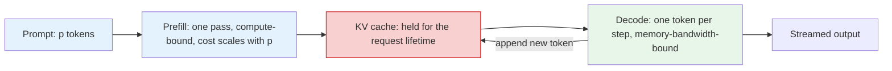

Request scheduling in LLM serving determines, at each iteration of an autoregressive model's forward pass, which requests are admitted to the running set, which of them are included in the batch, and how much of each request's work the batch carries. A CPU scheduler selects the next job to run; an LLM serving scheduler instead makes three nested decisions on different timescales:

1. **Admission** (per request): does this request enter the running set at all, given KV-cache and SLO headroom? This is the [[systems/scheduling/4-cluster-and-datacenter/admission-control-backpressure-overload|admission-control]] problem with VRAM as the bounded buffer.
2. **Batch composition** (per iteration, ~tens of ms): which admitted requests run in this forward pass, and how much prefill is included with the decodes?
3. **Token-step selection** (inside the iteration): when compute or memory is scarce, which request's token is produced; this is the priority and fairness decision.

The three decisions fail in different ways. Poor admission overflows the KV cache and forces preemptions, poor batch composition violates the per-token SLO, and a poor token-step policy starves some requests. The queueing and fairness principles are those of other schedulers, but the cost model is specific to LLM serving.

## Prefill and Decode Costs

Autoregressive serving has two major phases:

- **prefill**: process the input prompt
- **decode**: generate one token at a time

Prefill consists of large matrix multiplications and is compute-bound. Decode is dominated by KV-cache reads and other memory traffic.



The scheduling decisions follow from a simple cost model (constants derived in [[ml/serving-systems/performance-modeling|Performance Modeling]]). A prefill over $p$ prompt tokens costs one pass of compute proportional to $p$, so a 2,000-token prompt costs roughly 2,000 tokens' worth of FLOPs in one iteration. A decode step costs one token of compute per request but must stream the *entire model plus that request's KV cache* through memory. Decode alone is therefore memory-bandwidth-bound at any realistic batch size, and adding decodes to a batch adds little time until the batch approaches the compute roofline. Three consequences follow for scheduling:

- A batch of decodes runs at nearly the speed of one decode, so filling the batch increases throughput at little cost in latency.
- One large prefill inserted into a decode batch lengthens that iteration for *every* request in it, because all of the prompt's tokens require compute in that iteration, so the inter-token latency of every co-scheduled request increases.
- KV-cache memory, rather than compute, typically limits the size of the running set, since each active request holds cache proportional to its live token count for its entire lifetime.

One scheduler therefore solves two different resource-allocation problems, coupled through a shared memory budget.

## Batching as a Scheduling Decision

Batch size is the principal control available to the serving scheduler, and its effects extend beyond throughput:

- Large batches improve hardware utilization.
- Large batches increase waiting time.
- Prefill-heavy batches can stall decode-heavy workloads.

The choice of batch size is therefore a scheduling tradeoff.

## Continuous Batching

The central idea of [Orca](https://www.usenix.org/system/files/osdi22-yu.pdf) is **iteration-level scheduling**: the scheduler invokes the engine for a single forward pass at a time, so new work enters at token-step boundaries instead of waiting for an entire request batch to drain, and finished requests exit immediately rather than padding out the batch. The companion mechanism, **selective batching**, allows mixed batches to execute: element-wise and linear ops batch across requests regardless of their differing lengths, while attention runs per-request. Together these give Orca its reported 36.9x throughput improvement over request-level batching at equivalent latency.

Iteration-level scheduling reduces idle batch slots, but it also introduces interference between requests:

- long prefills can delay many decodes
- long decodes consume KV-cache capacity for a long time

## Admission and Preemption in vLLM

[vLLM](https://arxiv.org/abs/2309.06180) is a widely used implementation of the admission layer. PagedAttention allocates KV cache in fixed-size blocks on demand (memory management is described in [[ml/serving-systems/memory-management|Memory Management]]), which turns admission into a block-budget problem. The scheduler admits requests from the FCFS queue while free blocks remain above a watermark, a reserve kept so that running requests, whose future lengths are unknown, can grow for a few steps before memory is exhausted.

When growth exceeds the reserve, the scheduler must **preempt**: it evicts a running request's KV blocks and either **swaps** them to host memory (inexpensive to write, but re-admission is limited by PCIe bandwidth) or **discards and recomputes** the cache later (which spends FLOPs, but recomputation of a whole prompt is one efficient prefill, often faster than paging the cache back in). vLLM preempts the newest request first, which protects the requests in which the most work has been invested. Because output lengths are unpredictable, *some* preemption mechanism is necessary, and the design choice is whether its cost is paid in bandwidth or in FLOPs, the same recompute-versus-store tradeoff as in gradient checkpointing.

## Chunked Prefill and Disaggregation

Chunked prefill ([Sarathi](https://arxiv.org/abs/2308.16369)) divides the prompt into bounded pieces so that very long prompts delay decodes less. Each iteration carries a prefill chunk, limited by a token budget, alongside the decode batch, so prompt work uses the spare compute of the memory-bound decode iterations. Prefill/decode disaggregation ([DistServe](https://arxiv.org/abs/2401.09670)) places the two phases on different machines or pools, so that TTFT and inter-token latency no longer compete for the same iteration budget, at the cost of transferring KV caches between pools.

Both techniques apply two older scheduling principles:

- classify work by the shape of its service demand
- serve incompatible classes of work through separate queues

The separation of short and long flows in [[systems/scheduling/3-network-and-packet/fair-queueing-wfq-and-drr|fair queueing]] is the same principle, with long prompts in the role of long flows.

## Scheduling Objectives

A serving scheduler typically pursues several objectives:

- maximize throughput
- keep TTFT below a target
- keep per-token latency below a target
- avoid starvation of long prompts
- share service fairly across users

These objectives conflict. A scheduler that greedily favors short prompts can achieve a low mean latency while serving users with long contexts too slowly to be usable.

**Fairness in LLM serving** must account for request cost. Requests differ by orders of magnitude in cost (a 10-token question vs a 100k-token document), so fairness counted per request does not equalize service. The [Virtual Token Counter](https://arxiv.org/abs/2401.00588) (OSDI 2024) applies WFQ to this setting. It keeps a per-client virtual counter that advances with *weighted service received* (the cost function weights input and output tokens differently, e.g. output tokens ~2x input, reflecting compute cost), and at each iteration admits work from the client with the lowest counter. The difference in service between backlogged clients remains bounded by a constant, the WFQ/DRR fairness guarantee with tokens in place of bytes, and a client that floods requests increases only its own counter, so clients are isolated without per-request rate limits. Counters do not advance while a client is idle, so an idle client accumulates no credit, as with DRR's deficit reset.

## Skeleton Scheduler Loop

The following is one iteration of a scheduler modeled on vLLM, with the three decision layers in the order in which they run: running requests first (they hold committed cache), then preemption if the cache overflowed, then admission with chunked prefill under a per-iteration token budget:

```python
def schedule_iteration(running, waiting, free_blocks, watermark,
                       token_budget, fair_counters):
    batch = []

    for req in running:                       # 1. decodes: one token each,
        need = blocks_for_next_token(req)     #    may need one new block
        if need > free_blocks:
            victim = newest(running)          # preempt: newest-first,
            free_blocks += release(victim)    # recompute-later policy
            waiting.appendleft(victim)
            if victim is req:
                continue
        free_blocks -= need
        batch.append((req, 1))                # (request, tokens this pass)

    budget = token_budget - len(batch)        # 2. spare compute this pass
    while waiting and budget > 0:
        req = min(waiting, key=lambda r: fair_counters[r.client])  # 3. VTC pick
        chunk = min(req.remaining_prefill, budget)
        need = blocks_for(chunk)
        if need > free_blocks - watermark:    # admission: keep the reserve
            break
        free_blocks -= need
        waiting.remove(req)
        batch.append((req, chunk))
        budget -= chunk
        fair_counters[req.client] += cost(chunk_in=chunk)

    return batch                              # one fused forward pass
```

Production systems add further mechanisms (swapping, priority classes, SLO deadlines, length prediction), but their schedulers follow the structure of this loop: a capacity check against the block budget, a latency check against the iteration token budget, a fairness check by counter, and then admission.

## Scheduling Heuristics

- Short and long prompts are separated where possible.
- Very long prefills are bounded so that they do not repeatedly increase decode latency.
- KV-cache capacity is treated as a first-class scheduling resource.
- Fairness is tracked per user as well as per request.
- Work is rejected or deferred early if admitting it would make an SLO violation certain.

## Related Notes

- [[ml/serving-systems/batching|Batching]]
- [[ml/serving-systems/performance-modeling|Performance Modeling]]
- [[ml/serving-systems/memory-management|Memory Management]]
- [[systems/scheduling/4-cluster-and-datacenter/admission-control-backpressure-overload|Admission Control, Backpressure, and Overload Management]]
- [[systems/scheduling/3-network-and-packet/fair-queueing-wfq-and-drr|Fair Queueing, WFQ, and DRR]]
- [[systems/scheduling/4-cluster-and-datacenter/stragglers-speculation-and-overload|Stragglers, Speculation, and Overload]]

